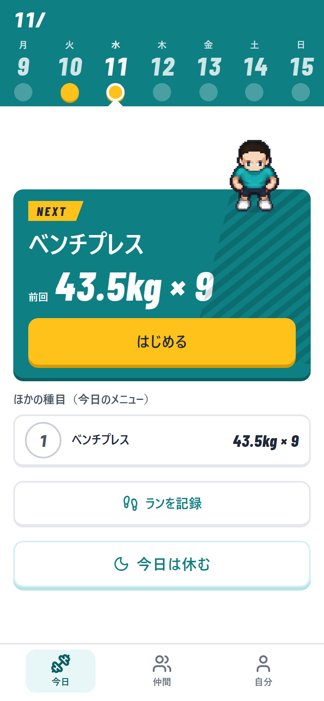
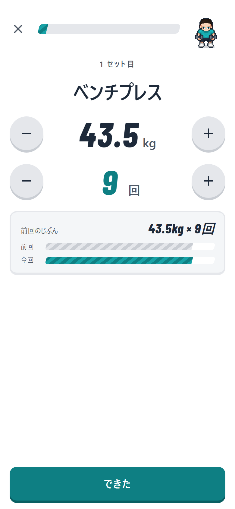
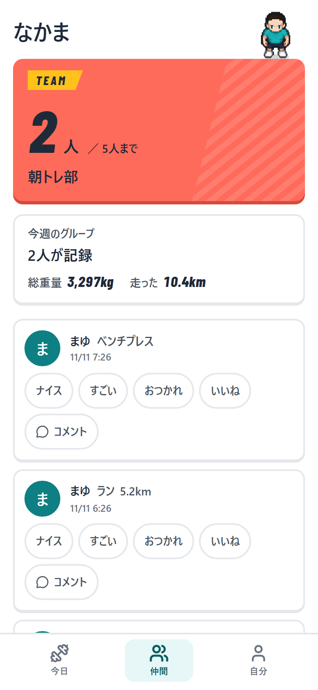

# FitLog — 筋トレとランの記録アプリ

[](https://github.com/yusu31/FitLog/actions/workflows/ci.yml)

少人数（最大5人）で使う、筋トレ＋ランの記録アプリです。プログラミングスクール RaiseTech の上級編最終課題として開発しました。

柱は2つです。

- **ゴースト対戦**: 記録中に「前回の自分」と並ぶバーを出し、前回の値が最初から入った状態で「できた」を1タップで記録します
- **仲間と見せ合う**: グループの仲間の記録（足跡）に、スタンプやコメントを返せます

連続日数は持たず、「今週の7マス」で見せます。休んだ日も責めません（「今日は休む」も記録のひとつです）。


> 上の動画は、前回値の入った記録 →「できた」→ 仲間タブでスタンプ、の一連の操作です（架空のユーザー・架空のデータ）。

| 今日 | 記録 | 仲間 |
|---|---|---|
|  |  |  |

> 画面は、ローカルで架空のユーザー・架空のデータを入れて撮っています。キャラクターはドット絵の素材（LPC）を使っています（作者とライセンスは、アプリの「設定 → クレジット」に載せています）。

---

## 主な機能

| 機能 | 内容 | ID |
|------|------|----|
| ユーザー登録・ログイン | メールアドレス + パスワード。Cookie セッション | F-01 |
| グループ | 作成・招待リンクで参加・退出。最大5人 | F-02 |
| 筋トレの記録 | 種目（部位つきの一覧。無ければ追加）・重量・回数。前回の値が入り、「できた」でセットを記録 | F-03 |
| ランの記録 | 距離・時間の手入力、または GPX の取り込み。ルートは地図に表示 | F-04 / F-14 / F-15 |
| ゴースト | 前回の自分と並ぶバー。上回った・同じ・下回ったを見せる | F-05 |
| 記録直後の祝福 | 短い祝福。自己ベストには「ベスト」の札 | F-06 |
| 今週の7マス・今日は休む | 連続日数を持たない継続表示。休みも記録として残る | F-07 / F-08 |
| 仲間の足跡・スタンプ・コメント | 仲間の記録と今週のグループ合計。同じスタンプの二重付与は防ぐ | F-09 / F-10 |
| 初回の体験 | 説明なしで最初の1セットを記録できる。お試しのゴースト付き | F-11 |
| 筋肉ヒートマップ | 今週鍛えた部位を体の図に色で表示 | F-12 |
| 2秒ラストレップ動画 | 画面の中で2秒だけ撮影。仲間に見えるのはその週の終わりまで | F-13 |
| オフライン記録 | 電波がなくても端末に先に保存し、つながったら自動で送る。同じ記録が2回届いても1件 | F-30 |
| ドット絵のキャラ（最小版）・クレジット | 場面に合わせたポーズ。編集画面は未実装 | F-31 / F-33 |

受け入れ条件は [機能一覧](./docs/features.md) にあります。範囲（必須／できれば／やらない）の正本は [要件定義書](./docs/requirements.md) です。

## 技術スタック

| 役割 | 技術 |
|------|------|
| フロントエンド | Next.js 16（静的書き出し）・TypeScript・shadcn/ui・Tailwind CSS・TanStack Query・Serwist |
| バックエンド | NestJS 12（AWS Lambda 上）・Drizzle ORM・better-auth |
| データベース | PostgreSQL（Neon） |
| 配信 | S3 + CloudFront（画面）／ Lambda（API）。構成は Terraform |
| 地図 | MapLibre GL JS + PMTiles |
| テスト | Vitest・Testing Library・Playwright（E2E・アクセシビリティ検査 axe） |
| CI | GitHub Actions（lint・型・テスト・ビルド・秘密情報の検査・CodeQL） |

選定の理由と、却下した案は [技術スタック](./docs/tech-stack.md) にあります。

## ドキュメント

設計書は `docs/` にあり、分冊・重複なしで書いています。

| 文書 | 内容 |
|------|------|
| [要件定義書](./docs/requirements.md) | 目的・ペルソナ・機能要件・非機能要件 |
| [機能一覧](./docs/features.md) | 機能ごとの受け入れ条件 |
| [画面設計](./docs/screen-design.md) | 画面と遷移・デザインの決まり |
| [設計](./docs/design.md) | API・認証・セキュリティの設計 |
| [DB 設計](./docs/database-design.md) | テーブルと制約 |
| [技術スタック](./docs/tech-stack.md) | 採用技術・却下した案と理由 |
| [インフラ](./docs/infrastructure.md) | AWS 構成・公開の手順と実績 |
| [テスト設計](./docs/testing-design.md) | テストの方針と一覧 |
| [運用](./docs/operations.md) | ログ・監視・運用 |
| [スケジュール](./docs/schedule.md) | 見積もりと実績 |

## ローカルで動かす

必要なもの: Node.js・npm・Docker（開発用の PostgreSQL に使います）

```bash
docker compose up -d                      # 開発用の DB（PostgreSQL・PgBouncer）
cd backend && cp .env.example .env       # 環境変数（中身の説明は .env.example のコメント）
cd backend && npm ci && npm run build && node dist/main   # API（3000番）
cd frontend && npm ci && npm run dev                      # 画面（3001番。/api/* は 3000番へ転送されます）
```

本物の接続文字列・署名鍵は Git に入れません（`.env` は `.gitignore` 済み）。

## テスト

```bash
cd backend  && npm test          # API の単体テスト（結合テストは CI で本物の PostgreSQL に対して実行）
cd frontend && npm test          # 画面の単体テスト
cd frontend && npm run test:e2e  # E2E とアクセシビリティ検査（ローカルの DB が必要）
```

テストは、実行件数が表示されることまで確かめて完了としています。

## 公開について

AWS 上への公開構成（CloudFront + S3 / Lambda）は Terraform で定義し、実機で動作を確認しています。

## 開発の進め方

Issue → ブランチ → PR → マージの順で進め、main への直接プッシュはしていません。CI が通らない変更はマージできません。

## ライセンス・素材

キャラクターのドット絵は LPC（Liberated Pixel Cup）の素材を使っています。作者・ライセンスは [`frontend/public/characters/CREDITS.md`](./frontend/public/characters/CREDITS.md) とアプリ内のクレジット画面にあります。数字用フォントは Barlow Condensed（SIL Open Font License）です。
