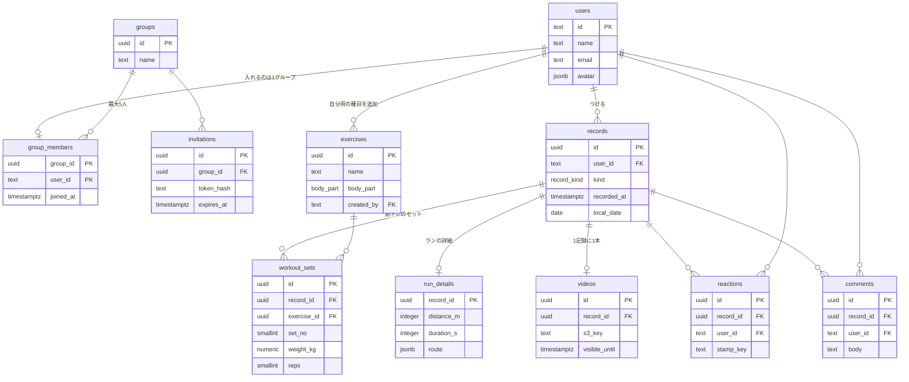

# データベース設計書

## FitLog

ER 図・テーブル定義・列挙値・インデックスを定義する。使う技術は [tech-stack.md](./tech-stack.md)（PostgreSQL = Neon Free・Drizzle）、機能は [features.md](./features.md) を正とする。

> **書き方:** 列名は `snake_case`。Drizzle のスキーマ（`pgTable`）の名前もこれにそろえる。
> **実装を正とする:** 実装でスキーマが変わったら、本書を直す。

---

## 1. ER 図

認証のテーブル（`sessions`・`accounts`・`verifications`）は better-auth が作るので、本書には載せない（版を固定するときに、実際の定義を [tech-stack.md](./tech-stack.md) に写す）。

### 設計のポイント

- **端末で作る ID（UUID）を主キーにする**（`records`・`workout_sets`・`reactions`・`comments`）。オフラインで作った記録が、再送されても二重にならないため（F-30）。API は、同じ ID が来たら新しく作らず成功を返す（`INSERT ... ON CONFLICT (id) DO NOTHING`）
- **`records` は「1回の記録の入れ物」**。筋トレ・ラン・休みの3種類を `kind` で分け、種類ごとの中身は `workout_sets`（筋トレ）・`run_details`（ラン）に持つ。休みは中身がない。足跡・7マス・仲間の一覧が `records` だけで引けるようにするため
- **日付は `local_date`（日本時間の日付）を列に持つ**。`recorded_at` は端末の時刻（UTC で保存）で、`local_date` はサーバーが `recorded_at` から Asia/Tokyo で出す。「7マス」「おかえり」「週の合計」を、時刻の計算なしに日付の比較だけで引けるようにするため（リスク #3）
- **1人1グループ**を DB の制約で守る（`group_members.user_id` を一意にする）。人数の上限 5 人は制約では守れないので、参加の処理で数え直す。**トランザクションで囲むだけでは足りない**: PostgreSQL の既定（READ COMMITTED）では、2人が同時に「4人」と数えて、両方が追加して6人になる。**数える前に `groups` の行を `SELECT ... FOR UPDATE` でロックする**（トランザクション単位のロックなので、Neon の PgBouncer のトランザクションモードでも使える。公式: https://www.postgresql.org/docs/current/transaction-iso.html）
- **集計用のテーブルは作らない**。週・月の合計、ヒートマップ、7マスは、その都度 `records`・`workout_sets` から集計する（少人数で件数が少ないため。遅くなったら見直す）
- **画面で組み立てるキャラ（決定11）の設定は、`users.avatar` の1列に持つ**（jsonb）

---

## 2. テーブル定義

### users（ユーザー）※ better-auth が管理する表に列を足す

| 列名 | 型 | 制約 | 説明 |
|------|-----|------|------|
| id | text | PK | better-auth が作る ID |
| name | text | NOT NULL | 表示名（1〜20字） |
| email | text | NOT NULL・UNIQUE | メールアドレス |
| email_verified | boolean | NOT NULL | better-auth の列 |
| image | text |  | better-auth の列（使わない） |
| avatar | jsonb | NOT NULL | キャラの設定。`{"body":"A","hair":1,"hairColor":"brown","shirtColor":"teal","pantsColor":"navy"}`。既定値は体型 A・髪型 1・既定の色 |
| created_at | timestamptz | NOT NULL |  |
| updated_at | timestamptz | NOT NULL |  |

### groups（グループ）

| 列名 | 型 | 制約 | 説明 |
|------|-----|------|------|
| id | uuid | PK | |
| name | text | NOT NULL | 1〜20字 |
| created_by | text | FK → users.id | 作った人 |
| created_at | timestamptz | NOT NULL | |

### group_members（グループのメンバー）

| 列名 | 型 | 制約 | 説明 |
|------|-----|------|------|
| group_id | uuid | PK（複合）・FK → groups.id | |
| user_id | text | PK（複合）・FK → users.id・**UNIQUE** | UNIQUE により、1人が入れるグループは1つ |
| joined_at | timestamptz | NOT NULL | |

### invitations（招待）

| 列名 | 型 | 制約 | 説明 |
|------|-----|------|------|
| id | uuid | PK | |
| group_id | uuid | FK → groups.id・NOT NULL | |
| token_hash | text | NOT NULL・UNIQUE | 招待リンクの値の SHA-256（元の値は保存しない） |
| expires_at | timestamptz | NOT NULL | 作ってから7日 |
| created_by | text | FK → users.id | |
| created_at | timestamptz | NOT NULL | |
| revoked_at | timestamptz |  | 取り消したとき（既定は NULL） |

### exercises（種目）

| 列名 | 型 | 制約 | 説明 |
|------|-----|------|------|
| id | uuid | PK | 部位つきの一覧（約30種目）は、マイグレーションで固定の ID を入れる |
| name | text | NOT NULL | 1〜30字 |
| body_part | body_part | NOT NULL | ヒートマップの部位。種目ごとに1つ |
| created_by | text | FK → users.id | 自分で追加した種目の作者。**一覧の種目は NULL**。NULL でなければ、その人にだけ見える |

### records（記録）

| 列名 | 型 | 制約 | 説明 |
|------|-----|------|------|
| id | uuid | PK | 端末で作る UUID |
| user_id | text | FK → users.id・NOT NULL | |
| kind | record_kind | NOT NULL | `workout`（筋トレ）・`run`（ラン）・`rest`（休み） |
| recorded_at | timestamptz | NOT NULL | 端末の時刻。未来の時刻（5分より先）は 400 |
| local_date | date | NOT NULL | 日本時間の日付。サーバーが `recorded_at` から出す |
| created_at | timestamptz | NOT NULL | サーバーが保存した時刻 |

制約: `kind = 'rest'` のとき、同じ `user_id`・`local_date` の組は1件だけ（部分一意インデックス。休みは1日1件）。

### workout_sets（筋トレのセット）

| 列名 | 型 | 制約 | 説明 |
|------|-----|------|------|
| id | uuid | PK | 端末で作る UUID |
| record_id | uuid | FK → records.id・NOT NULL・ON DELETE CASCADE | `kind = 'workout'` の記録だけを指す（API で確かめる） |
| exercise_id | uuid | FK → exercises.id・NOT NULL | |
| set_no | smallint | NOT NULL | その種目の何セット目か（1から）。同じ `record_id`・`exercise_id` の中で一意 |
| weight_kg | numeric(4,1) | NOT NULL | 0〜500（0.5 刻み）。自重の種目は 0 |
| reps | smallint | NOT NULL | 1〜999 |
| created_at | timestamptz | NOT NULL | |

### run_details（ランの詳細）

| 列名 | 型 | 制約 | 説明 |
|------|-----|------|------|
| record_id | uuid | PK・FK → records.id・ON DELETE CASCADE | `kind = 'run'` の記録だけ |
| distance_m | integer | NOT NULL | 100〜200,000（0.1〜200km） |
| duration_s | integer | NOT NULL | 60〜86,400 |
| route | jsonb |  | GPX から作った間引き済みのルート（GeoJSON の LineString。上限 3,000 点）。手入力は NULL |
| gpx_s3_key | text |  | 元の GPX を S3 に置いたときのキー（置かなければ NULL） |

### videos（動画）

| 列名 | 型 | 制約 | 説明 |
|------|-----|------|------|
| id | uuid | PK | |
| record_id | uuid | FK → records.id・**UNIQUE**・ON DELETE CASCADE | 1記録に1本 |
| s3_key | text | NOT NULL | S3 のキー |
| content_type | text | NOT NULL | 撮影できた形式（`video/mp4` など） |
| size_bytes | integer | NOT NULL | 上限 10MB（10,485,760） |
| visible_until | timestamptz | NOT NULL | 仲間に見える期限。記録の週の日曜 24:00（日本時間）。**本人は期限に関係なく見られる**。URL の発行のときに確かめる |
| created_at | timestamptz | NOT NULL | |

### reactions（スタンプ）

| 列名 | 型 | 制約 | 説明 |
|------|-----|------|------|
| id | uuid | PK | 端末で作る UUID |
| record_id | uuid | FK → records.id・NOT NULL・ON DELETE CASCADE | |
| user_id | text | FK → users.id・NOT NULL | |
| stamp_key | text | NOT NULL | 固定の数種類のキー（画面とコードの定数。DB には一覧を持たない） |
| created_at | timestamptz | NOT NULL | |

制約: `(record_id, user_id, stamp_key)` は一意（同じスタンプの二重付与を防ぐ）。

### comments（コメント）

| 列名 | 型 | 制約 | 説明 |
|------|-----|------|------|
| id | uuid | PK | 端末で作る UUID |
| record_id | uuid | FK → records.id・NOT NULL・ON DELETE CASCADE | |
| user_id | text | FK → users.id・NOT NULL | |
| body | text | NOT NULL・CHECK（1〜50字） | 定型文でも自由入力でも、本文をそのまま保存する |
| created_at | timestamptz | NOT NULL | |

自分のコメントは削除できる（物理削除）。

---

## 3. 列挙値（Enum）の定義

| 名前 | 値 | 説明 |
|------|-----|------|
| record_kind | workout / run / rest | 記録の種類 |
| body_part | chest / back / shoulders / arms / abs / glutes / legs | ヒートマップの部位。**7つは仮置き**で、体の図（F-12）の領域に合わせて実装のときに増減する。増減したときは本書を直す |

スタンプのキーと定型コメントは、DB の列挙値にせずコードの定数にする（増やすたびにマイグレーションを要さないため）。

---

## 4. インデックス設計

| テーブル | インデックス | 使うところ |
|----------|-------------|-----------|
| records | `(user_id, local_date DESC)` | 7マス・月のカレンダー・おかえりの判定 |
| records | `(user_id, recorded_at DESC)` | 自分の記録の一覧（段階的に読み込む） |
| records | UNIQUE `(user_id, local_date)` WHERE `kind = 'rest'` | 休みは1日1件 |
| workout_sets | UNIQUE `(record_id, exercise_id, set_no)` | 同じセット番号の二重登録を防ぐ |
| workout_sets | `(exercise_id, record_id)` | 前回の取得（ゴースト）・自己ベストの判定 |
| group_members | UNIQUE `(user_id)`・`(group_id)` | 1人1グループ・グループのメンバー一覧 |
| invitations | UNIQUE `(token_hash)`・`(group_id)` | 招待リンクの検索 |
| reactions | UNIQUE `(record_id, user_id, stamp_key)` | 二重付与の防止・記録ごとの一覧 |
| comments | `(record_id, created_at)` | 記録ごとのコメント一覧 |
| exercises | `(created_by)` | 自分が追加した種目の一覧 |

「前回の取得」のクエリ（同じ種目の直近の記録のセット）は、`records(user_id, recorded_at DESC)` と `workout_sets(exercise_id, record_id)` を使う。件数が増えて遅くなったら、実行計画（`EXPLAIN`）を見て直す。

---

## 5. マイグレーション

Drizzle（`drizzle-kit generate` → `migrate`）で管理する。順序は次のとおり（実装フェーズで番号を確定する）。

| 順 | 内容 |
|----|------|
| 1 | better-auth の表（users・sessions・accounts・verifications）。`users` に `avatar` を足す |
| 2 | groups・group_members・invitations |
| 3 | body_part・exercises（一覧の種目を固定の ID で入れる） |
| 4 | record_kind・records・workout_sets・run_details |
| 5 | reactions・comments |
| 6 | videos |

テストでは、マイグレーションを空の DB に最初から流して通ること、2回流しても壊れないことを確かめる。
