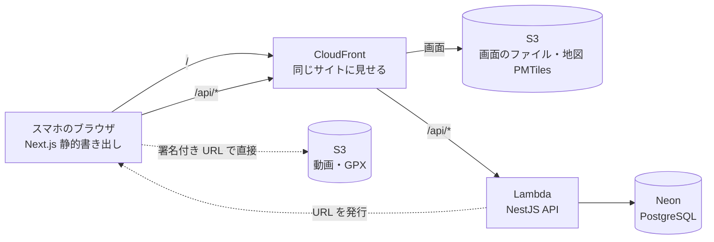

# 設計書（API・システム構成）

## FitLog

システム構成・認証・API エンドポイント・エラーレスポンス・セキュリティ設計を定義する。
使う技術と選定理由は [tech-stack.md](./tech-stack.md)、テーブルは [database-design.md](./database-design.md)、機能の受け入れ条件は [features.md](./features.md) を正とする。AWS の構成の詳細は infrastructure.md（基本設計で作成）に書き、本書には書き写さない。

> **書き方:** 画面用の型は、本書の API を `@nestjs/swagger` で OpenAPI にしたものから orval で生成する。**画面用の型（DTO）の名前に `Record` を使わない**（TypeScript の組み込みの型とぶつかる）。記録は `TrainingRecord` とする。

---

## 1. システム構成



- 画面と API は**同じサイト**（CloudFront の下の `/api/*`）に置く。Cookie が同じサイトのものとして送られ、CORS の設定が要らない
- 動画と GPX は、ブラウザが S3 へ**直接**置く（API は署名付き URL を発行するだけ）。変換サーバーは置かない
- 地図のファイル（PMTiles）は S3 + CloudFront から配り、ブラウザが直接読む（Lambda を通さない）

---

## 2. 認証方式

better-auth（Drizzle アダプター）＋ Cookie セッション。

| 項目 | 内容 |
|------|------|
| ログイン | メールアドレス + パスワード。成功すると、`HttpOnly`・`Secure`・`SameSite=Lax` の Cookie でセッションを発行する |
| 認証の API | better-auth が提供する `/api/auth/*`（登録・ログイン・ログアウト・セッションの確認）をそのまま使う。実際のパスは版を固定するときに確かめ、このページへ写す |
| 保護された API | `/api/auth/*` 以外はすべて、ログイン済みであることを確かめる（共通のガード）。していなければ 401 |
| 他人のデータ | 記録・スタンプ・コメント・動画は、**同じグループのメンバーか**を毎回確かめる（6章） |

---

## 3. API エンドポイント一覧

前提: パスの先頭は `/api`。リクエストとレスポンスは JSON。日時は ISO 8601（UTC）で送り、日付（`localDate`）は `YYYY-MM-DD`（日本時間の日付）。ID は UUID。
「冪等（べきとう）」は、同じリクエストを2回送っても結果が1回分と同じこと（F-30 の再送のため、作成系はすべて冪等にする）。

### ユーザー

| メソッド | パス | 説明 | 備考 |
|----------|------|------|------|
| GET | `/me` | 自分のユーザー情報（名前・キャラの設定・入っているグループ） | |
| PATCH | `/me` | 名前・キャラの設定（`avatar`）を変更する | F-32 |

### グループ（F-02）

| メソッド | パス | 説明 | 備考 |
|----------|------|------|------|
| POST | `/groups` | グループを作る | すでにグループにいると 409 |
| GET | `/groups/current` | 今のグループとメンバー（名前・キャラの設定）を返す | グループにいなければ 404 |
| POST | `/groups/current/invitations` | 招待リンクを作る | リンクの値は**このレスポンスの1回だけ**返す |
| GET | `/invitations/{token}` | 招待の内容（グループ名・今の人数）を見る | 期限切れ 410・取り消し済み 404 |
| POST | `/invitations/{token}/accept` | 参加する | 満員 409・すでに別のグループ 409・期限切れ 410 |
| DELETE | `/groups/current/members/me` | グループを出る | |

### 種目（F-03）

| メソッド | パス | 説明 | 備考 |
|----------|------|------|------|
| GET | `/exercises` | 一覧の種目＋自分が追加した種目 | |
| POST | `/exercises` | 自分用の種目を追加する（`name`・`bodyPart`） | 同じ名前は 409 |
| GET | `/exercises/{id}/previous` | **前回**（同じ種目の直近の記録）のセットと、自己ベストを返す（ゴースト・F-05・F-06） | 前回がなければ空 |

### 記録（F-03・F-04・F-08・F-14）

| メソッド | パス | 説明 | 備考 |
|----------|------|------|------|
| POST | `/records` | 記録を作る（`id`・`kind`・`recordedAt`。`kind=run` なら `run` も） | **冪等**。休みは同じ日に2回でも1件 |
| POST | `/records/{id}/sets` | 筋トレのセットを足す（`id`・`exerciseId`・`setNo`・`weightKg`・`reps`） | **冪等**。再送のとき、記録の作成を先に送る（送信待ちは作った順に送る） |
| DELETE | `/records/{id}/sets/{setId}` | セットを消す（取り消し） | 自分のだけ |
| DELETE | `/records/{id}` | 記録を消す | 自分のだけ |
| GET | `/records` | 自分の記録の一覧（新しい順・`cursor`・`limit` 20） | 段階的に読み込む |
| GET | `/records/{id}` | 記録の詳細（セット・ラン・動画の有無） | 自分か同じグループの人のだけ |
| POST | `/records/{id}/gpx` | GPX の元ファイルを置く署名付き URL を発行する | ルートの読み取りは画面側。上限 5MB |

### 7マス・足跡・集計（F-07・F-09・F-12）

| メソッド | パス | 説明 | 備考 |
|----------|------|------|------|
| GET | `/week?date=YYYY-MM-DD` | その日を含む週の、自分の7マス（日ごとに `rec`・`rest`・なし） | 週は月曜〜日曜 |
| GET | `/feed?weekStart=YYYY-MM-DD&cursor=` | 同じグループの足跡（新しい順・20件ずつ）と、その週の合計 | |
| GET | `/me/heatmap?weekStart=YYYY-MM-DD` | その週の部位ごとのセット数 | F-12 |

### スタンプ・コメント（F-10）

| メソッド | パス | 説明 | 備考 |
|----------|------|------|------|
| POST | `/records/{id}/reactions` | スタンプを付ける（`id`・`stampKey`） | **冪等**。同じスタンプの二重付与は1件のまま |
| DELETE | `/records/{id}/reactions/{reactionId}` | 自分のスタンプを外す | |
| POST | `/records/{id}/comments` | コメントを付ける（`id`・`body` 1〜50字） | **冪等** |
| DELETE | `/comments/{id}` | 自分のコメントを消す | 他の人のは 403 |

### 動画（F-13）

| メソッド | パス | 説明 | 備考 |
|----------|------|------|------|
| POST | `/records/{id}/video` | 動画を置く署名付き URL（POST 形式）を発行し、`videos` の行を作る | 自分の筋トレの記録だけ。1記録に1本（2本目は 409）。上限 10MB を署名の条件に入れる |
| GET | `/videos/{id}/url` | 動画を見る署名付き URL を発行する | **本人はいつでも**。**仲間は `visible_until` の前だけ**（過ぎていれば 403） |

### その他

| メソッド | パス | 説明 |
|----------|------|------|
| GET | `/health` | 生きているかの確認（DB には触れない）。認証不要 |

---

## 4. レスポンス例

### GET /api/exercises/{id}/previous（前回の取得）

```json
{
  "previous": {
    "recordedAt": "2026-10-25T09:12:00.000Z",
    "sets": [
      { "setNo": 1, "weightKg": 40, "reps": 10 },
      { "setNo": 2, "weightKg": 40, "reps": 10 },
      { "setNo": 3, "weightKg": 40, "reps": 8 }
    ]
  },
  "personalBest": { "weightKg": 45, "reps": 8, "volume": 360 }
}
```

前回がなければ `"previous": null`。

### POST /api/records/{id}/sets（セットを足す）

```json
{ "id": "5f0e…", "exerciseId": "b1d2…", "setNo": 2, "weightKg": 40, "reps": 11 }
```

レスポンス（201。同じ ID の2回目は 200 で同じ内容）:

```json
{
  "id": "5f0e…",
  "setNo": 2,
  "weightKg": 40,
  "reps": 11,
  "result": "up",
  "isPersonalBest": false
}
```

`result` は `up`（前回超え）・`same`・`down`。**`down` は「負け」と表示せず、責めない言い方にする**（F-05）。

---

## 5. エラーレスポンス形式

NestJS の例外フィルターで、すべてのエラーを次の形にそろえる。

```json
{
  "statusCode": 409,
  "code": "GROUP_FULL",
  "message": "このグループは満員です",
  "details": null
}
```

| 項目 | 内容 |
|------|------|
| statusCode | HTTP ステータス |
| code | 機械が読む短い文字列（`GROUP_FULL`・`ALREADY_IN_GROUP`・`INVITATION_EXPIRED`・`VALIDATION_FAILED` など） |
| message | 画面に出せる日本語の文言。**内部の事情（SQL・スタックトレース・パス）を入れない** |
| details | 入力エラーのとき、項目ごとの理由の配列。それ以外は `null` |

### HTTP ステータスコード一覧

| コード | 意味 | 使う場面 |
|--------|------|----------|
| 200 | 成功 | 取得・更新・冪等な作成の2回目 |
| 201 | 作成した | 作成の1回目 |
| 204 | 成功（本文なし） | 削除 |
| 400 | 入力が正しくない | 範囲の外・形式の違い・未来の時刻・51字のコメント |
| 401 | ログインしていない | セッションなし・期限切れ（F-30: 送信待ちは捨てない） |
| 403 | 権限がない | 他人のコメントを消す・見られる期限を過ぎた動画 |
| 404 | 見つからない | 存在しない ID。**他グループの記録も 404 を返す**（存在を教えない） |
| 409 | 状態が合わない | 満員・すでに別のグループ・動画が2本目 |
| 410 | 期限切れ | 招待リンク |
| 413 | 大きすぎる | GPX・動画の上限超え（署名の条件で S3 が断るので、API では GPX の読み取り後に返す） |
| 500 | サーバーの不具合 | 想定外。詳細は返さず、ログにだけ残す |

---

## 6. セキュリティ設計

| 脅威 | 対策 | 確かめ方（テスト） |
|------|------|--------------------|
| 他グループのデータが見える | **記録を取るクエリは1か所の共通関数を通す**。その関数が、グループのメンバーかの条件（`group_members` との結合）を必ず付ける。個別の API に条件を散らさない。他グループのものは 404 | 結合テスト: 別グループの人が `/records/{id}`・`/feed`・`/videos/{id}/url` を呼ぶと 404 |
| 招待リンクの推測・使い回し | 128 ビット以上の乱数・DB にはハッシュだけ・7日の期限・取り消せる | 期限切れが 410・満員が 409 |
| 動画の URL が漏れる | 署名付き URL は短い有効期限（5分。既定）で、発行のたびに権限を確かめる。仲間は `visible_until` の前だけ | 期限後に仲間が呼ぶと 403 |
| 大きなファイル・形式違い | 動画は署名の条件にサイズの上限（10MB）と形式を入れる。GPX は画面で5MB の上限と XML の検査をし、API は座標の範囲（緯度 ±90・経度 ±180）と点の数（3,000）を再確認する | 範囲外の座標が 400 |
| SQL インジェクション | Drizzle のパラメータ渡しだけを使う。SQL 文字列を手で組み立てない | — |
| XSS | React の自動エスケープ。`dangerouslySetInnerHTML` を使わない。コメント・名前はそのまま保存し、表示のときにエスケープされる | コメントに `<script>` を入れても文字として出る |
| ログイン情報の漏れ | パスワードは better-auth のハッシュ化に任せる。ログにパスワード・Cookie・招待リンクの値・署名付き URL を出さない | ログの出力をテストで検査する |
| 二重送信 | 作成系は端末で作った ID で冪等にする | 同じ ID を2回送って1件 |

### ログ

NestJS が構造化ログ（JSON）を出す。レベルは ERROR（即対応）・WARN（潜在的な問題）・INFO（業務上の重要イベント。グループの作成・参加、動画の発行など）・DEBUG（開発調査用）。本番は INFO。1行に、リクエスト ID・ユーザー ID（本人を特定できる値だけ。メールアドレスは出さない）・パス・ステータス・処理時間を持つ。詳しくは operations.md（基本設計で作成）。
