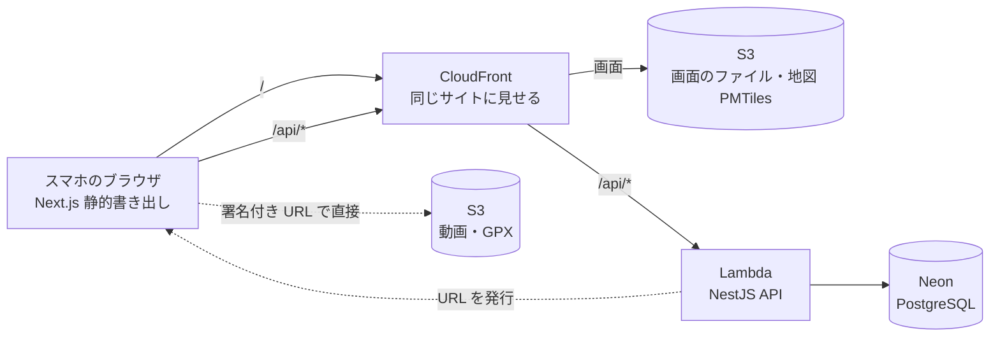

# 設計書（API・システム構成）

## FitLog

システム構成・認証・API エンドポイント・エラーレスポンス・セキュリティ設計を定義する。
使う技術と選定理由は [tech-stack.md](./tech-stack.md)、テーブルは [database-design.md](./database-design.md)、機能の受け入れ条件は [features.md](./features.md) を正とする。AWS の構成の詳細は [infrastructure.md](./infrastructure.md) に書き、本書には書き写さない。

> **書き方:** 画面用の型は、本書の API を `@nestjs/swagger` で OpenAPI にしたものから orval で生成する。**画面用の型（DTO）の名前に `Record` を使わない**（TypeScript の組み込みの型とぶつかる）。記録は `TrainingRecord` とする。

---

## 1. システム構成



- 画面と API は**同じサイト**（CloudFront の下の `/api/*`）に置く。Cookie が同じサイトのものとして送られ、API には CORS の設定が要らない（動画・GPX を置く S3 側は、ブラウザから直接送るので CORS が要る。[infrastructure.md](./infrastructure.md) を参照）
- 動画と GPX は、ブラウザが S3 へ**直接**置く（API は署名付き URL を発行するだけ）。変換サーバーは置かない
- 地図のファイル（PMTiles）は S3 + CloudFront から配り、ブラウザが直接読む（Lambda を通さない）

---

## 2. 認証方式

better-auth（Drizzle アダプター）＋ Cookie セッション。

| 項目 | 内容 |
|------|------|
| ログイン | メールアドレス + パスワード。成功すると、`HttpOnly`・`Secure`・`SameSite=Lax` の Cookie でセッションを発行する |
| 認証の API | better-auth が提供する `/api/auth/*`（登録・ログイン・ログアウト・セッションの確認）をそのまま使う。版は better-auth 1.7.14・連携部品（`@thallesp/nestjs-better-auth`）2.8.0 で固定。確かめたパス: `POST /api/auth/sign-up/email`（表示名・メール・パスワード。成功すると、そのままログイン済み）・`POST /api/auth/sign-in/email`・`POST /api/auth/sign-out`・`GET /api/auth/get-session`。画面の側は `better-auth/react` の `authClient` を通して呼ぶ |
| 保護された API | `/api/auth/*`・`GET /invitations/{token}`・`GET /health` 以外はすべて、ログイン済みであることを確かめる（共通のガード）。していなければ 401 |
| ログイン不要の例外 | `GET /invitations/{token}` だけ。招待リンクを開いた未登録の人に「どのグループに招かれたか」を見せるため。返すのは**グループ名と今の人数だけ**（メンバーの名前・記録は返さない）。リンクの値は推測できない乱数で7日の期限があるので、見えるものを絞れば足りる（判断ログ 01-7） |
| 登録時のメール確認 | **送らない**。最大5人・招待リンクを持つ人しか入れないため。代わりにパスワードの再設定は作らない（[要件定義書の「やらない」](./requirements.md)） |
| 別のサイトからの書き込み（CSRF） | `/api/auth/*` は better-auth の Origin 検査（知らない送信元は 403。`advanced.disableOriginCheck: false` を明示。既定ではテスト環境で検査が飛ぶため）。それ以外の API は `SameSite=Lax` の Cookie が、別のサイトからの POST・PATCH・DELETE に付かないことで守る。連携部品 2.8.0 に Nest 側の Origin 検査の設定は無い。02-2 で書き込み API が増えたら、共通の Origin 検査を足すか判断する |
| 登録済みメールの探られやすさ・総当たり | 登録時は「このメールアドレスは登録済み」と画面に出す（どのメールが登録済みか分かる）。**最大5人・招待リンクを持つ人しか登録しない設計なので、許容する**（ログインの失敗は「メールかパスワードが違う」と分けない）。総当たりへの回数制限は better-auth の既定（本番で有効）に任せるが、**この制限は Lambda の中のメモリに持つため、インスタンスが複数になると効きが弱くなる**（推測。02-1 ③b の公開スパイクで、複数同時に動くときの挙動を確かめる）。効かなければ、保存先を DB にするか、CloudFront 側の制限を検討する |
| 他人のデータ | 記録・スタンプ・コメント・動画は、**同じグループのメンバーか**を毎回確かめる（6章） |

---

## 3. API エンドポイント一覧

前提: パスの先頭は `/api`。リクエストとレスポンスは JSON。日時は ISO 8601（UTC）で送り、日付（`localDate`）は `YYYY-MM-DD`（日本時間の日付）。ID は UUID。
「冪等（べきとう）」は、同じリクエストを2回送っても結果が1回分と同じこと（F-30 の再送のため、作成系はすべて冪等にする）。

### ユーザー

| メソッド | パス | 説明 | 備考 |
|----------|------|------|------|
| GET | `/me` | 自分のユーザー情報（名前・キャラの設定・入っているグループ） | |
| PATCH | `/me` | 名前・キャラの設定（`avatar`）を変更する | F-32 |

### グループ（F-02）

| メソッド | パス | 説明 | 備考 |
|----------|------|------|------|
| POST | `/groups` | グループを作る | すでにグループにいると 409 |
| GET | `/groups/current` | 今のグループとメンバー（名前・キャラの設定）を返す | グループにいなければ 404 |
| POST | `/groups/current/invitations` | 招待リンクを作る | リンクの値は**このレスポンスの1回だけ**返す |
| GET | `/invitations/{token}` | 招待の内容（グループ名・今の人数）を見る | **ログイン不要**（2章）。期限切れ 410・取り消し済み 404 |
| POST | `/invitations/{token}/accept` | 参加する | 満員 409・すでに別のグループ 409・期限切れ 410 |
| DELETE | `/groups/current/invitations/{id}` | 招待リンクを取り消す（`revoked_at` に時刻を入れる。行は消さない） | 自分のグループの招待だけ。すでに取り消し済みでも 204（冪等）。`id` は招待を作ったレスポンスで返す |
| DELETE | `/groups/current/members/me` | グループを出る | |

### 種目（F-03）

| メソッド | パス | 説明 | 備考 |
|----------|------|------|------|
| GET | `/exercises` | 一覧の種目＋自分が追加した種目 | |
| POST | `/exercises` | 自分用の種目を追加する（`name`・`bodyPart`） | 同じ名前（大文字小文字は区別しない）は 409。一覧の種目と同じ名前も 409 |
| GET | `/exercises/{id}/previous` | **前回**（同じ種目の直近の記録）のセットと、自己ベストを返す（ゴースト・F-05・F-06）。`?friendId=`（同じグループの仲間の userId）を付けると、その人の前回を返す（F-16。自己ベストは null。同じグループでない・自分・無い id は 404 `FRIEND_NOT_FOUND`。自作の種目は仲間の同じ名前の種目と突き合わせる）。`?before=`（ISO 8601）を付けると、その時刻より前の記録だけを見る（記録中の自分の記録を前回にしないため、画面は今の記録の時刻を渡す） | 前回がなければ `previous: null`。種目が無い・他の人の種目は 404 `EXERCISE_NOT_FOUND`。`before` が日時でなければ 400 |

### 記録（F-03・F-04・F-08・F-14）

| メソッド | パス | 説明 | 備考 |
|----------|------|------|------|
| POST | `/records` | 記録を作る（`id`・`kind`・`recordedAt`。`kind=run` なら `run: { distanceM, durationS }` も必須。距離 100〜200000 m・時間 60〜86400 秒の整数。run を他の kind に付けると 400。記録と詳細は同じトランザクションで入れ、再送の応答には1回目の `run` が入る。GPX を取り込んだランは `run.route`（GeoJSON の LineString・点は [経度, 緯度]・2〜3000 点）も送れる。3001 点・LineString でない・範囲外の座標は 400。`route` を返すのは詳細 `GET /records/{id}` だけで、作成の応答と一覧には入れない） | **冪等**。休みは同じ日に2回でも1件。任意の `late: true`（あとから記録。F-21）を付けると、応答・一覧・詳細・足跡に `late:true` が付く（`false` は付けないのと同じ。休みに `true` は 400）。動画の署名付き URL は late の記録には発行せず 409 `RECORD_LATE`。任意の `copiedFromUserId`（メニューのコピー。F-24）は筋トレだけ（他は 409）、同じグループの仲間だけ（404 `FRIEND_NOT_FOUND`）。応答・一覧・詳細に `copiedFrom: { name }`（コピー元が今も同じグループなら名前、抜けていれば null）が付く。詳細の各種目に `bodyPart` も入る |
| POST | `/records/{id}/sets` | 筋トレのセットを足す（`id`・`exerciseId`・`setNo`・`weightKg`・`reps`） | **冪等**。再送のとき、記録の作成を先に送る（送信待ちは作った順に送る） |
| DELETE | `/records/{id}/sets/{setId}` | セットを消す（取り消し） | 自分のだけ。成功は 204。他の人の記録・無い記録は 404 `RECORD_NOT_FOUND`、その記録にセットが無い（別の記録のセット・もう消した）は 404 `SET_NOT_FOUND`。**二重削除は 2回目が 404**（7章） |
| DELETE | `/records/{id}` | 記録を消す | 自分のだけ。成功は 204。セット・ランの詳細は `ON DELETE CASCADE` で一緒に消える。他の人の記録・無い id・もう消した記録は、どれも同じ 404 `RECORD_NOT_FOUND`（7章） |
| GET | `/records` | 自分の記録の一覧（新しい順・`cursor`・`limit` 既定 20・最大 100。`kind` で絞れる） | 段階的に読み込む。応答は `{ items, nextCursor }`（最後のページの `nextCursor` は `null`）。筋トレの記録は、種目ごとのセットを含めて返す（今日のメニューを画面が作る材料。`kind=workout&limit=1`）。`limit`・`kind`・`cursor` が正しくなければ 400 `VALIDATION_ERROR`。4章に応答例 |
| GET | `/records/{id}` | 記録の詳細（セット・ラン。動画の有無は動画の PR で足す） | 自分か同じグループの人のだけ。別のグループ・グループに入っていない人・無い id は、どれも同じ 404 `RECORD_NOT_FOUND`（存在を教えない）。応答の形は一覧の1件と同じ |
| POST | `/records/{id}/gpx` | GPX の元ファイルを置く署名付き URL（**POST 形式**。動画と同じ）を発行する | ルートの読み取りは画面側。上限 5MB（5,242,880 バイト）を署名の条件に入れる |

### 7マス・足跡・集計（F-07・F-09・F-12）

| メソッド | パス | 説明 | 備考 |
|----------|------|------|------|
| GET | `/week?date=YYYY-MM-DD` | その日を含む週の、自分の7マス。応答は `{ weekStart, days: [{ date, status }] × 7 }`（月曜から日曜の順。`status` は `rec`・`rest`・`none`） | 週は月曜〜日曜（日本時間）。同じ日に記録と休みがあれば `rec`。`date` が実在する日付でない・無いときは 400 |
| GET | `/feed?weekStart=YYYY-MM-DD&cursor=` | 同じグループの足跡（新しい順・20件ずつ）と、その週の合計 | `weekStart` は必須で、その日を含む週（月曜〜日曜）を返す（水曜を渡しても月曜に直す）。応答は `{ weekStart, items, nextCursor, totals }`。`items` の1件は `id`・`kind`・`recordedAt`・`localDate`・`author`（`id`・`name`・`avatar`）・`exerciseNames`（筋トレの種目名。重複なし）・`run`（ランだけ）・`stamps`（付いたものだけ。`stampKey`・`count`・`mine`＝自分のスタンプの id か `null`）・`commentCount`。`totals` は `recordedUserCount`（筋トレかランを記録した人。休みだけの人は数えない）・`totalVolumeKg`・`totalDistanceM`（ページに関係なく週全体）。**自分の記録も含む**。グループに入っていなければ 200 で `items` は空・`totals` は 0。`weekStart` が日付でない・`cursor` が壊れていれば 400 |
| GET | `/me/heatmap?weekStart=YYYY-MM-DD` | その週の部位ごとのセット数 | F-12 |
| GET | `/me/stats?date=YYYY-MM-DD` | 記録をくわしく。応答は `{ today, calendar: [{ date, status }] × 365, month: { month, activeDays, restDays, totalWeightKg, runDistanceM }, weekly: [{ weekStart, totalWeightKg, runDistanceM }] × 12, stamps: [{ key, earned }] × 13 }`。`date` は今日（日本時間）。自分の記録だけを全期間から日ごとにまとめる（共通の関数 `common/stats.ts`）。不正な `date` は 400 | F-20・F-22・F-26・F-27・F-29 |

### スタンプ・コメント（F-10）

| メソッド | パス | 説明 | 備考 |
|----------|------|------|------|
| GET | `/records/{id}/comments` | その記録のコメント一覧。応答は `{ items: [{ id, recordId, body, createdAt, author }] }` | 古い順（`createdAt` の昇順・同時刻は `id` の昇順）・全件（仲間は最大5人なのでページ分けしない）。自分のコメントも入る。コメントが無ければ `items: []`。見られない記録（無い・別グループ・UUID でない）は 404 `RECORD_NOT_FOUND`（無い記録と同じ応答） |
| GET | `/records/{id}/reactions` | その記録のスタンプの集計。応答は `{ items: [{ stampKey, count, mine }] }`（足跡 `/feed` の `stamps` と同じ形） | 付いたものだけ、スタンプの一覧の順。`mine` は自分が付けたスタンプの `id`（外すとき `DELETE` へ渡す。付けていなければ `null`）。スタンプが無ければ `items: []`。見られない記録は 404 `RECORD_NOT_FOUND` |
| POST | `/records/{id}/reactions` | スタンプを付ける（`id`・`stampKey`）。応答は `{ id, recordId, stampKey }` | **冪等**。同じ `id` の再送も、同じスタンプの別 `id` での二重付与も 200 で、付いているスタンプ（1回目の `id`）を返し1件のまま。`stampKey` は `nice`・`fire`・`clap`・`smile`（筋トレ・ラン用）と `rest_slow`・`rest_again`（休み用）だけで、ほかは 400。種類に合わないもの（休みに通常のスタンプ・筋トレ／ランに休み用）は 409 `RECORD_KIND_MISMATCH`。見られない記録は 404 `RECORD_NOT_FOUND`、他の人のスタンプと同じ `id` は 404 `REACTION_NOT_FOUND` |
| DELETE | `/records/{id}/reactions/{reactionId}` | 自分のスタンプを外す | 成功は 204。見られない記録は 404 `RECORD_NOT_FOUND`、その記録に無い・もう外した（二重削除）は 404 `REACTION_NOT_FOUND`、他の人のは 403 `FORBIDDEN` |
| POST | `/records/{id}/comments` | コメントを付ける（`id`・`body` 1〜50字）。応答は `{ id, recordId, body, createdAt, author }` | **冪等**（同じ `id` の再送は 200 で1回目の内容）。空白だけは 400。見られない記録は 404 `RECORD_NOT_FOUND`、他の人のコメントと同じ `id` は 404 `COMMENT_NOT_FOUND`。本文はそのまま保存する |
| DELETE | `/comments/{id}` | 自分のコメントを消す | 成功は 204。他の人のは 403 `FORBIDDEN`（記録の持ち主でも）。無い・もう消した・見られない記録のコメントは 404 `COMMENT_NOT_FOUND` |

### 動画（F-13）

| メソッド | パス | 説明 | 備考 |
|----------|------|------|------|
| POST | `/records/{id}/video` | 動画を置く署名付き URL（POST 形式）を発行し、`videos` の行を作る | 自分の筋トレの記録だけ（筋トレでなければ 409 `RECORD_KIND_MISMATCH`・他人の記録は 404）。本文は `{ contentType, sizeBytes }`（画面の申告。形式は `video/mp4`・`video/webm`、大きさは 1〜10,485,760 バイト）。**署名の条件は、大きさが申告値ちょうど・形式とキーが完全一致**（S3 が申告と違うものを受け付けない）。キーは `videos/{記録の id}`。1記録に1本で、**置くのに失敗したやり直しは同じ記録にもう一度呼ぶ**（行は1つのまま申告を更新し、同じキーで署名し直す。初回 201・再発行 200）。応答は `{ id, upload: { url, fields }, expiresInSeconds, visibleUntil }` |
| GET | `/videos/{id}/url` | 動画を見る署名付き URL を発行する | **本人はいつでも**。**仲間は `visible_until` の前だけ**（過ぎていれば 403 `FORBIDDEN`）。別のグループの人・グループに入っていない人・無い id は 404 `VIDEO_NOT_FOUND`（存在を教えない）。置き場（環境変数 `VIDEO_BUCKET`）が未設定の環境では、署名を頼む両方の API が 503 `VIDEO_STORAGE_UNAVAILABLE` |

### その他

| メソッド | パス | 説明 |
|----------|------|------|
| GET | `/health` | 生きているかの確認（DB には触れない）。認証不要。外部の死活監視はこれだけに向ける |
| GET | `/health/db` | DB まで届くかの確認（`select 1`）。届かなければ 503 `DB_UNAVAILABLE`。**02-1 ③ の共通ガードと一緒にログイン必須にする**（誰でも叩けると、Neon が止まらず月の計算時間を使い切る恐れがある。0.25 CU で常時起きていると約182時間/月で、無料枠は100時間） |

---

## 4. レスポンス例

### GET /api/exercises/{id}/previous（前回の取得）

```json
{
  "previous": {
    "recordedAt": "2026-10-25T09:12:00.000Z",
    "sets": [
      { "setNo": 1, "weightKg": 40, "reps": 10 },
      { "setNo": 2, "weightKg": 40, "reps": 10 },
      { "setNo": 3, "weightKg": 40, "reps": 8 }
    ]
  },
  "personalBest": { "weightKg": 45, "reps": 8, "volume": 360 }
}
```

前回がなければ `"previous": null`。

### POST /api/records/{id}/sets（セットを足す）

```json
{ "id": "5f0e…", "exerciseId": "b1d2…", "setNo": 2, "weightKg": 40, "reps": 11 }
```

レスポンス（201。同じ ID の2回目は 200 で同じ内容）:

```json
{
  "id": "5f0e…",
  "setNo": 2,
  "weightKg": 40,
  "reps": 11,
  "result": "up",
  "isPersonalBest": false
}
```

`result` は `up`（前回超え）・`same`・`down`。前回の同じセット番号と比べる（前回にその番号が無ければ前回の最後のセット）。**前回がなければ `null`**。**`down` は「負け」と表示せず、責めない言い方にする**（F-05）。

`isPersonalBest` は、その種目で「このセットより前」の過去最大の重量×回数を超えたとき true（同じは false・初めての記録は false）。「前」は、別の記録なら `recorded_at` が自分の記録より前、同じ記録ならセット番号が小さいもの。自分自身を数えないので、同じ `id` の再送でも `result`・`isPersonalBest` は1回目と同じになる。

### GET /api/records（記録の一覧）と GET /api/records/{id}（詳細）

詳細 `GET /api/records/{id}` だけ、動画があるとき `videoId`（uuid）が付く（見るときは `GET /videos/{videoId}/url`。一覧には付けない）。動画の行は署名付き POST を発行するときに作るので、S3 への送信が失敗した記録にも `videoId` は付く。画面は再生に失敗したら「再生できませんでした」とだけ出す。

`GET /api/records?kind=workout&limit=1` の応答（一覧。詳細は `items` の1件と同じ形）:

```json
{
  "items": [
    {
      "id": "c3a1…",
      "kind": "workout",
      "recordedAt": "2026-10-26T03:00:00.000Z",
      "localDate": "2026-10-26",
      "exercises": [
        {
          "exerciseId": "b1d2…",
          "name": "ベンチプレス",
          "sets": [
            { "id": "5f0e…", "setNo": 1, "weightKg": 40, "reps": 10 },
            { "id": "6a11…", "setNo": 2, "weightKg": 40, "reps": 11 }
          ]
        }
      ]
    }
  ],
  "nextCursor": "eyJ0IjoxNzYxNDQ…"
}
```

- `exercises` は**筋トレだけ**に付く（セットが無ければ `[]`）。ランは `run: { distanceM, durationS }`（詳細だけ GPX のルート `route` も付く）、休みはどちらも付かない。種目は最初にセットを足した順、セットはセット番号の昇順。セットには `result`・`isPersonalBest` を付けない（その場で記録するときに使うもの）
- 並びは `recordedAt` の降順、同じ時刻は `id` の降順。`nextCursor` は「最後に読んだ1件の（時刻, id）」で、中身は見ずにそのまま次の `cursor` に渡す。件数の数え直しや順番の入れ替えで、読んでいる間に記録が増えても重複・抜けが出ない（offset にしない理由）

---

## 5. エラーレスポンス形式

NestJS の例外フィルターで、すべてのエラーを次の形にそろえる。

```json
{
  "statusCode": 409,
  "code": "GROUP_FULL",
  "message": "このグループは満員です",
  "details": null
}
```

| 項目 | 内容 |
|------|------|
| statusCode | HTTP ステータス |
| code | 機械が読む短い文字列（`GROUP_FULL`・`ALREADY_IN_GROUP`・`INVITATION_EXPIRED`・`EXERCISE_ALREADY_EXISTS`・`VALIDATION_ERROR` など。入力エラーは 400 `VALIDATION_ERROR`） |
| message | 画面に出せる日本語の文言。**内部の事情（SQL・スタックトレース・パス）を入れない** |
| details | 入力エラーのとき、項目ごとの理由の配列。それ以外は `null` |

### HTTP ステータスコード一覧

| コード | 意味 | 使う場面 |
|--------|------|----------|
| 200 | 成功 | 取得・更新・冪等な作成の2回目 |
| 201 | 作成した | 作成の1回目 |
| 204 | 成功（本文なし） | 削除 |
| 400 | 入力が正しくない | 範囲の外・形式の違い・未来の時刻・51字のコメント |
| 401 | ログインしていない | セッションなし・期限切れ（F-30: 送信待ちは捨てない） |
| 403 | 権限がない | 他人のコメント・スタンプを消す（`FORBIDDEN`）・見られる期限を過ぎた動画 |
| 404 | 見つからない | 存在しない ID。**他グループの記録も 404 を返す**（存在を教えない） |
| 409 | 状態が合わない | 満員・すでに別のグループ・動画が2本目・記録の種類に合わないスタンプ |
| 410 | 期限切れ | 招待リンク |
| 413 | 大きすぎる | 使わない。GPX・動画の上限超えは、署名付き POST の条件で **S3 がブラウザに直接エラーを返す**（API を通らない）。画面は送る前にサイズを検査し、S3 のエラーも「大きすぎます」と表示する |
| 500 | サーバーの不具合 | 想定外。詳細は返さず、ログにだけ残す |

---

## 6. セキュリティ設計

| 脅威 | 対策 | 確かめ方（テスト） |
|------|------|--------------------|
| 他グループのデータが見える | **記録を取るクエリは1か所の共通関数を通す**。その関数が、グループのメンバーかの条件（`group_members` との結合）を必ず付ける。個別の API に条件を散らさない。他グループのものは 404 | 結合テスト: 別グループの人が `/records/{id}`・`/feed`・`/videos/{id}/url` を呼ぶと 404 |
| 招待リンクの推測・使い回し | 128 ビット以上の乱数・DB にはハッシュだけ・7日の期限・取り消せる | 期限切れが 410・満員が 409 |
| 動画の URL が漏れる | 署名付き URL は短い有効期限（5分。既定）で、発行のたびに権限を確かめる。仲間は `visible_until` の前だけ | 期限後に仲間が呼ぶと 403 |
| 大きなファイル・形式違い | 動画は署名の条件にサイズの上限（10MB）と形式を入れる。GPX は画面で5MB の上限と XML の検査をし、API は座標の範囲（緯度 ±90・経度 ±180）と点の数（3,000）を再確認する | 範囲外の座標が 400 |
| SQL インジェクション | Drizzle のパラメータ渡しだけを使う。SQL 文字列を手で組み立てない | — |
| XSS | React の自動エスケープ。`dangerouslySetInnerHTML` を使わない。コメント・名前はそのまま保存し、表示のときにエスケープされる | コメントに `<script>` を入れても文字として出る |
| ログイン情報の漏れ | パスワードは better-auth のハッシュ化に任せる。ログにパスワード・Cookie・招待リンクの値・署名付き URL を出さない | ログの出力をテストで検査する |
| 二重送信 | 作成系は端末で作った ID で冪等にする | 同じ ID を2回送って1件 |

### ログ

NestJS が構造化ログ（JSON）を出す。レベルは ERROR（即対応）・WARN（潜在的な問題）・INFO（業務上の重要イベント。グループの作成・参加、動画の発行など）・DEBUG（開発調査用）。本番は INFO。1行に、リクエスト ID・ユーザー ID（本人を特定できる値だけ。メールアドレスは出さない）・パス・ステータス・処理時間を持つ。詳しくは [operations.md](./operations.md)。

---

## 7. 細かい取り決め（テスト設計の洗い出しで決めたもの）

testing-design.md が「書かれていない」と洗い出した振る舞いを、ここで決める。本人に確認していない既定（判断ログ 01-5 の決定19と同じ扱い）。

| 場面 | 決め方 | コード |
|------|--------|--------|
| 同じセット番号を、別の ID で2回送る | 2回目は作らない | 409 `SET_NUMBER_TAKEN` |
| 休み・ランの記録に、筋トレのセットを足す | 作らない | 409 `RECORD_KIND_MISMATCH` |
| セット番号（`setNo`）の範囲 | 1〜99 の整数（設計書に上限が無かったので、1つの種目で足りる数として置いた既定。DB は CHECK 制約でも守る） | 範囲の外は 400 |
| セットの種目が、存在しない・他の人が追加した種目 | 作らない（存在を教えない） | 404 `EXERCISE_NOT_FOUND` |
| 他の人のセットと同じ `id` を送った | 作らず、中身も返さない | 404 `SET_NOT_FOUND` |
| 休みを、別の ID で同じ日に2回送る | 新しく作らず、すでにある休みを返す（休みは1日1件） | 200 |
| 記録・セットを消した後の、もう一度の削除（再送・二重タップ） | **2回目は 404**（記録は `RECORD_NOT_FOUND`、セットは `SET_NOT_FOUND`）。招待の取り消し（204 の冪等）と違い、消えた行の持ち主はもう分からない。「無い id は 204、他人の id は 404」にすると、204 か 404 かで他人の記録の有無が分かってしまうので、**無い・他人の・もう消した、をすべて同じ 404 にそろえた**。画面は 404 を「もう消えている」と受け取ればよい | 404 |
| 記録を消したときの、ゴースト（前回）・自己ベスト | 消した記録は「前回」の元から外れる（前回は消えていない記録だけを見る）。すでに表示した結果は出し直さない | — |
| 一覧の `limit`・`cursor`・`kind` | `limit` は 1〜100 の整数（既定 20。設計書は 20 だけで上限が無かったので、1回で全件を取れないよう 100 を置いた既定）。`kind` は workout / run / rest。`cursor` は前の応答の `nextCursor` だけ（壊れていれば 400） | 範囲の外は 400 `VALIDATION_ERROR` |
| 記録の詳細を見られる人 | 持ち主と、**同じグループ**の人。グループを出た人の記録は、出たあとは仲間から見えない（T-GRP-07）。判定は `group_members` の同じ `group_id` を1か所の関数（`backend/src/records/record-access.ts` の `ownerInMyGroup`・`visibleToMe`）で引く。足跡・スタンプ・コメントも同じ関数を通す | 見えない相手には 404 |
| 招待リンクの判定の順番 | 取り消し済み（404）→ 期限切れ（410）→ すでに別のグループ（409 `ALREADY_IN_GROUP`）→ 満員（409 `GROUP_FULL`） | 左の順に最初に当たったもの |
| 招待の期限ちょうど | `expires_at` 以後は期限切れ（ちょうどの瞬間は無効） | 410 |
| 動画の見られる期限ちょうど | `visible_until` 以後は、仲間には見せない（本人は見られる） | 403 |
| コメントの「50字」 | Unicode の**コードポイント数**で数える（画面は `Array.from(text).length`、API も同じ、DB の `char_length` と一致）。絵文字1つも1字 | 51字目は 400 |
| GPX の点の数が 3,000 を超える | 画面が間引いてから送る。API に 3,000 超が届いたら受けない | 400 |
| 1回の運動の区切り（3時間） | **画面が判定する**。API は区切りを知らず、来た記録の ID をそのまま保存する | — |
| 日付をまたぐ運動 | 記録の `local_date` は、**記録を作った時点**（最初のセット）の日付 | — |
| 重量を軽くして回数を稼いだとき | 決定14のとおり「重量×回数」が大きければ「上回った」（例: 40kg×10 → 30kg×14 は 420 対 400 で上回る）。変えない | — |
| 送れなかったときの送信待ちの扱い（F-30） | 5xx・408・429・ネットワーク断は**送信待ちに残して**、間隔を空けて再送する（件数の上限なし。帯に「送信待ち N件」）。作成系は冪等なので再送は安全。400・403・409 は再送しても直らないので送信待ちから外し、「送れなかった記録」として1回だけ知らせる。401 は捨てない（再ログイン後に送る）。404 は親（記録の作成）の順番待ちの可能性があるので、同じ `scope` の中で親が成功するまで待つ（判断ログ 01-7） | — |
| 冪等な作成で、**他人の** ID とぶつかったとき | 衝突したら既存の行を読み、`user_id` が自分でなければ **404**（存在を教えない。4章の 404 と同じ方針）、自分なら 200 で同じ内容。セットは、親の `records.user_id` が自分かを必ず確かめる | 404 |
| 電波がないときの結果・自己ベスト・日付 | 比べ方（決定14）と日本時間の `local_date` の計算を**共通の関数**にし、画面と API の両方で使う。画面はその場で仮に表示し、**API の応答が正**。違えば画面を直す（祝福は出し直さない）。前回は「`recorded_at` が自分より前の記録」だけを見る（再送で前回が入れ替わらないように） | — |
| スタンプ・コメントの二重削除 | 2回目は 404（`REACTION_NOT_FOUND`・`COMMENT_NOT_FOUND`）。他の人のものは 403。ただし**別のグループの記録**は、スタンプ・コメントがあっても 404 `RECORD_NOT_FOUND`／`COMMENT_NOT_FOUND`（403 にすると存在が分かるため） | 404・403 |
| スタンプと記録の種類（T-STP-06） | 休みの記録には休み用（`rest_slow`・`rest_again`）だけ、筋トレ・ランには通常（`nice`・`fire`・`clap`・`smile`）だけ。合わない組み合わせは 409 `RECORD_KIND_MISMATCH`。一覧は `backend/src/feed/stamps.ts` の定数が正で、画面設計書の表と同じ | 409 |
| 空白だけのコメント（T-CMT-07） | 受け付けない（`trim()` して空なら 400）。それ以外は前後の空白も含めてそのまま保存する | 400 |
| 週の合計の「記録した人数」 | 筋トレかランを記録した人だけ数える（休みは数えない）。自分が休んでも仲間の数字は減らず、増えもしない | — |
