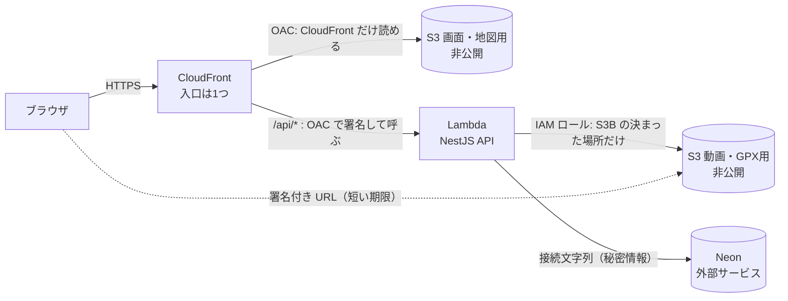

# インフラ構成（基本設計）

## FitLog

AWS 上に何を置き、誰に何を許し、いくらかかる見込みかを決める。
システム全体の流れ（画面・API・DB・ファイルの関係）は [design.md の 1章](./design.md#1-システム構成) を正とし、本書には書き写さない。使う技術の一覧と理由は [tech-stack.md](./tech-stack.md)、運用（ログ・監視）は operations.md（基本設計で作成）を正とする。

| 項目 | 内容 |
|------|------|
| ステータス | **基本設計（仮置きを含む）**。実際に動かして確かめるのは、まず **02-1 ③ の最後の「半日の公開スパイク」**（使い捨て。通信まわりの不確かさだけ前倒しで確かめる）、本番の構築は 02-3（インフラ構築）。ここまでは調べて書いただけで、AWS には何も作っていない |
| 調査日 | 2026-10-28（費用・上限は下の各所に出典 URL を付ける） |
| 方針 | 原則無料で運用する。課金が発生する操作（`terraform apply` など）は**実行前に必ず本人に確認する** |

> **印の意味:** 「**決定**」＝tech-stack.md で決済み／「**仮置き**」＝今の推奨。スパイク（02-1 ③）か 02-3 で動かして確定する／「**未決**」＝まだ選んでいない／「**未確認**」＝調べたが公式で確かめられず、数字を書かない（理由つき）。

---

## 1. 概要と構成図

画面・API・動画／GPX・地図は、すべて **CloudFront という1つの入口**から配る。入口が1つなので、画面と API は「同じサイト」になり、Cookie がそのまま送られる（CORS 設定が API には要らない）。

下の図は、design.md の図に**権限の向き**（誰が誰を読めるか）を足したもの。流れの説明は design.md に任せ、ここでは「何が非公開で、何が経由を強制されるか」だけを見る。

---

## 2. 使う AWS のサービスと役割

| サービス | 役割 | 状態 |
|----------|------|------|
| CloudFront | 入口。`/api/*` は Lambda へ、それ以外は S3A へ振り分ける。HTTPS もここで受ける（証明書は既定の `*.cloudfront.net`。独自ドメインは持たない） | 決定 |
| S3（画面・地図用） | 静的書き出しのファイルと PMTiles の置き場 | 決定 |
| S3（動画・GPX 用） | 利用者がアップロードする動画と GPX の置き場 | 決定 |
| Lambda | NestJS の API を動かす。使った時間だけ課金される | 決定 |
| Lambda の公開口 | CloudFront から Lambda をどう呼ぶか | **仮置き**（3章） |
| IAM | 最小権限の実行ロールなど（4章） | 決定 |
| CloudWatch Logs | Lambda のログ置き場（Lambda 標準） | 決定 |
| 秘密情報の置き場 | 接続文字列・署名鍵 | **仮置き**（8章） |

### 2.1 CloudFront の振り分け

| パス | 行き先 | キャッシュ |
|------|--------|-----------|
| `/api/*` | Lambda | **しない**（ログインした本人ごとに答えが違うため）。Cookie・クエリ文字列・認証に使うヘッダーはそのまま Lambda へ渡す |
| それ以外（画面・地図） | S3A | する（ファイル名にハッシュが付く静的ファイルが中心） |

**画面のファイルの引き方（`index.html` の読み替え）:** S3 を OAC で読む（REST 形式の origin）と、`/records/` のようなパスが自動では `index.html` に読み替わらず、403/404 になる（既知の挙動とされるが、今回は公式で確認していないので**推測寄り**）。直し方は2つを組み合わせる。①`next.config` の `trailingSlash` を **02-1 ② で決める**（書き出されるファイルの形が変わるため、早く決める） ②CloudFront Function（CloudFront の手前で動く短い関数）で、末尾が `/` のパスに `index.html` を付ける。②は 02-3 で作り、スパイクで先に試してもよい。

**外向きアドレスと転送の設定:** better-auth に教える外向きアドレス（`https://xxxx.cloudfront.net`）は、環境変数ではなく **Parameter Store に手で入れて起動時に読む**（8章）。環境変数に入れようとすると「Lambda の設定に CloudFront のドメインが要る → CloudFront の行き先は Function URL → Function URL は Lambda に依存」と輪になり、1回の `apply` で作れないため（依存関係からの推論で、**推測**）。あわせて CloudFront の origin request policy では **Cookie・Origin・クエリ文字列を転送し、Host は渡さない**。better-auth が送信元の検査に Origin を使うかは**未確認**で、スパイクで確かめる。

**同じサイトに見せる理由:** Cookie は「どのサイトから来たか」で扱いが決まる。画面が `https://xxxx.cloudfront.net`、API が別ホストだと、Cookie が別サイト扱いになり、iPhone の Safari では特に送られにくい。入口を1つにすれば、この問題がそもそも起きない。

### 2.2 S3 を分けるか（比較）

| 案 | 内容 | メリット | デメリット |
|----|------|---------|-----------|
| A. 1つのバケット＋場所（プレフィックス）で分ける | `site/` `maps/` `uploads/` | 数が少ない | 「CloudFront だけ読める場所」と「Lambda が署名を発行する場所」を同じ方針（バケットポリシー）の中で書き分けるので、書き間違えると動画が公開されうる。CORS 設定もバケット単位なので、画面側にも掛かる |
| **B. 2つ（画面・地図用／動画・GPX 用）【採用・仮置き】** | design.md の図と同じ | 方針を**バケット単位で完全に分けられる**。画面用は「CloudFront だけが読める」、動画用は「Lambda の署名経由だけ」と1行で言える。ブラウザから直接アップロードする CORS 設定は動画用だけに掛ければ済む | バケットが2つ |
| C. 3つ（画面／地図／動画・GPX） | 地図も別 | 地図の差し替えが独立 | 画面と地図は同じ方針（CloudFront から読むだけ）なので、分ける利点が薄い |

**B を選ぶ理由:** 守りたいもの（動画の公開範囲）と、誰でも見てよいもの（画面・地図）を、**設定の単位で分けておく**と、設定ミスの影響範囲が小さくなる。**仮置き**なのは、02-3 で Terraform を書いて動かすまで確定しないため。

> **design.md との差:** design.md 1章は「CORS の設定が要らない」と書く。これは **API について正しい**。ただし**動画・GPX のアップロードはブラウザから S3B へ直接**行うので、S3B 側には CORS 設定が要る（許可する送信元は CloudFront のドメインだけ）。design.md に足すか判断が要る。

---

## 3. Lambda の公開の仕方の比較

CloudFront の裏に置く Lambda の「玄関」には、主に2つある。**Lambda Function URL**は、Lambda 1つにつき1つ付けられる専用の https アドレス。**API Gateway（HTTP API）**は、Lambda の前に置く API 専用の窓口サービス。

### 3.1 比較表

| 観点 | A. Function URL ＋ CloudFront OAC | B. Function URL（認証なし）＋ 秘密のヘッダー | C. API Gateway（HTTP API） |
|------|-----------------------------------|---------------------------------------------|---------------------------|
| 追加費用 | **なし**（Lambda の料金のみ）[^1] | なし | 100万リクエストあたり $1.00（最初の3億件。使用例の記載より）。新規顧客は100万件/月が12か月無料[^2] |
| 直接アクセスの防ぎ方 | AWS_IAM 認証。CloudFront が署名して呼ぶ（OAC）。Function URL を直接叩いても拒否される[^3] | URL は公開。CloudFront が付ける秘密のヘッダーを Lambda 内で検査。ヘッダーが漏れれば素通り | URL は公開。CloudFront が付ける秘密のヘッダーを検査するか、別の認可を足す（**未確認**: 窓口側だけで CloudFront 以外を拒否する標準の方法は、今回の調査では確認していない） |
| POST/PUT の注意 | **ブラウザが本文の SHA-256 を計算して `x-amz-content-sha256` ヘッダーに入れる必要がある**（Lambda が署名なしの本文を受け付けないため）[^3] | 不要 | 不要 |
| Cookie・ヘッダー | CloudFront の設定で Cookie を Lambda へ渡す。**Host ヘッダーは渡さない**（Lambda 側の署名検証に使うホスト名と食い違うため）[^3] | 同左（Host は渡さない運用になる見込み） | CloudFront の設定で渡す。Host の扱いは**未確認** |
| NestJS との相性 | Lambda 用のつなぎ部品（NestJS を Lambda のイベントに変換するもの）が要る。つなぎ部品が Function URL の形式に対応するかは **未確認** | 同左 | 同左（HTTP API の形式はつなぎ部品で広く使われているはずだが、今回は**未確認**） |
| 利点 | 部品が少なく、無料。直接アクセスを AWS の仕組みで防げる | 実装が最も単純 | 流量制限・ログなどの機能が豊富[^4] |
| 欠点 | 上の POST/PUT 条件が全 API に効く。画面側の送信処理（orval の生成物）に1行足す必要がある。**ログイン・登録は better-auth のクライアントが自前の fetch で POST する**ので、orval の生成物を直しても効かない。better-auth 側で同じヘッダーを付けられるかが分かれ目で、スパイクで確かめる（**未確認**） | 秘密のヘッダーの管理が要る。防御が弱い | 部品が1つ増え、リクエスト数に応じた費用が出る |

### 3.2 仮置きの推奨

**A（Function URL ＋ OAC）を仮置きで推奨する。** 理由は、費用が増えず、構成部品が最も少なく、直接アクセスを仕組みで防げるため。AWS 公式も、機能を絞った小さなアプリには Function URL を勧めている[^4]。

**ただし最大の不確実性は「ブラウザからの POST/PUT に必要なヘッダー」。** 公式には書いてあるが、FitLog の画面（fetch ＋ orval の生成物）で全 API に付けられるか、付けたときに実際に通るかは、まだ動かしていない。

> **02-1 ③ の最後の「半日の公開スパイク」で動かして確定する**（使い捨て。`terraform apply` は課金操作なので、実行の直前に本人へ確認する）。確かめること: ①CloudFront（OAC）経由で GET／POST／PATCH／DELETE が通る（公式の注意書きは PUT/POST のみで、PATCH・DELETE が通るかは**推測**） ②better-auth のログインが通り、Cookie が往復する ③ブラウザの fetch で SHA-256 を付けた POST が通る（`crypto.subtle` は HTTPS で使える。better-auth のクライアントの POST にも付けられるか） ④CloudFront の Free プランで Lambda Function URL を origin にできる（6章の**未確認**） ⑤コールドスタートと Neon 起床の実測（9章）。あわせて better-auth が外向きアドレス・Origin をどう扱うかも見る（2.1章。**未確認**）。⑥**6分以上空けた直後の1回目が失敗しないか**（5.2章。凍結中に Neon が切った接続を再利用して、最初の1回が DB エラーになる恐れ。**わざと失敗を一度見てから**、再試行・毎回つなぐ・作り直すのどれにするかを決める）。⑦DB が落ちているときのログの中身（SQL の引数・接続文字列が出ていないか）。
>
> **決めたこと（2026-10-28）:** ②③のどちらかが半日で通らなければ、**案B（Function URL の認証なし＋秘密ヘッダー）に落とす**。**C（API Gateway）は採らない**。C は A の欠点（SHA-256 ヘッダー）を消すだけで、防御は B と同じになり、費用と部品が増えるだけだから。B の弱さ（秘密ヘッダーが漏れれば素通り）の実害は、API が全部ログイン必須なので「直接叩かれても Cookie が無ければ 401」にとどまる。Lambda の費用を狙われる点は、予約済み同時実行数（5.2章）か AWS Budgets の通知で守る。
>
> **C を後で選ぶ条件:** ①利用者が増えて流量制限・利用量プランが要るとき ②SHA-256 の要件が better-auth・PATCH・DELETE で回避できず、かつ B の秘密ヘッダーでは防御が足りないと判断したとき。切り替えは Terraform と CloudFront の行き先だけで、画面・NestJS のコードは変わらない。

[^1]: https://docs.aws.amazon.com/lambda/latest/dg/furls-http-invoke-decision.html（2026-10-28 確認）
[^2]: https://aws.amazon.com/api-gateway/pricing/（2026-10-28 確認。無料枠は新規の AWS 利用者のみ）
[^3]: https://docs.aws.amazon.com/AmazonCloudFront/latest/DeveloperGuide/private-content-restricting-access-to-lambda.html（2026-10-28 確認）
[^4]: https://docs.aws.amazon.com/lambda/latest/dg/furls-http-invoke-decision.html（2026-10-28 確認）

---

## 4. ネットワーク・権限

### 4.1 ネットワーク

- Lambda は **VPC（AWS 内の専用ネットワーク）の外**に置く。DB の Neon は AWS の外にあるインターネット上のサービスで、Lambda を VPC に入れると外へ出るための追加部品（NAT ゲートウェイ）が要り、月額がかかる。無料で長く使う方針に合わない（前作の VPC・ALB・RDS 構成を採らない理由と同じ）
- 代わりに、Neon への接続は TLS（暗号化通信）で守る。Neon 側で接続元の IP を絞る機能は使わない（Lambda の出口 IP は固定されないため）。守りは「接続文字列を秘密にする」ことに寄せる

### 4.2 IAM（最小権限）

| 対象 | 許すこと | 許さないこと |
|------|---------|-------------|
| Lambda の実行ロール | ①ログを書く（標準の基本ポリシー）②S3B の**決まった場所**への PutObject／GetObject（署名付き URL を発行する人が、その操作の権限を持っている必要があるため[^5]）③秘密情報の読み取り（8章で決めた1〜2個だけ） | S3A への書き込み、`s3:*`、`*` への許可 |
| CloudFront から Lambda | OAC（`lambda:InvokeFunctionUrl` を、**この CloudFront のディストリビューションだけ**に許す）[^3] | 他の誰からの呼び出し |
| CloudFront から S3A | OAC で、**この CloudFront だけ**に読み取りを許す | それ以外の読み取り |
| デプロイする人（本人） | Terraform が作る範囲に限った権限（02-3 で具体化） | — |

**署名付き URL の有効期限:** IAM ロールの一時的な資格で作った URL は、**ロールの資格が切れた時点で無効になる**（指定した期限より早く切れることがある）[^5]。Lambda では資格が実行ごとに更新されるので、5分の URL が問題になる可能性は低いが、02-4（動画）の前に期限切れの挙動を確かめる。

> **決めたこと（2026-10-28）:** 動画・GPX のアップロードは**署名付き POST（presigned POST。`@aws-sdk/s3-presigned-post`）に統一**する。S3 でサイズの上限などの条件を付けられるのはフォーム送信形式（POST ポリシーの `content-length-range`）で、単純な PUT 用の URL では付けにくいため（PUT に上限を付ける公式の手段は確認できていない。**推測**）。上限は動画 10MB・GPX 5MB。
>
> - 上限を超えると、**ブラウザが S3 から直接エラーを受ける**。API は 413 を返せない（GPX は画面で 5MB を先に検査するので実害は小さい）
> - presigned POST は Lambda を通らないので、3章の SHA-256 の要件は動画・GPX のアップロードに関係しない（S3B へ直接送る）
> - 送信はフォーム形式（multipart）で、CORS は S3B にだけ掛ける（4.3章）
> - **未確認:** `content-length-range` が実際に効くか。公式の本文を取得できなかったため（原理的に不可能という意味ではない）。**02-4 の動画の前に実機で確かめる**。PUT しか使えないと分かったときは、design.md の書き方を直す
> - 2秒・720p の動画は 1MB 前後が見込みで（**推測**）、10MB は余裕のある値

[^5]: https://docs.aws.amazon.com/AmazonS3/latest/userguide/using-presigned-url.html（2026-10-28 確認）

### 4.3 公開設定

| 置き場 | 設定 |
|--------|------|
| S3A（画面・地図） | パブリックアクセスを**すべてブロック**。バケットポリシーは「この CloudFront のディストリビューションからの読み取りだけ」 |
| S3B（動画・GPX） | パブリックアクセスを**すべてブロック**。バケットポリシーで読み書きを許すのは、Lambda の実行ロールだけ。利用者は**署名付き URL でだけ**触れる。CORS は CloudFront のドメインだけを許す |
| どちらも | 暗号化は S3 の標準のまま（追加の鍵管理サービスは使わない。追加費用を避けるため。費用は**未確認**） |

「全部非公開、入口は CloudFront か署名付き URL だけ」とするので、S3 のアドレスを直接開いても何も見えない。

---

## 5. データベース（Neon Free）

### 5.1 無料枠の制限

出典: https://neon.com/docs/introduction/plans（2026-10-28 確認）

| 項目 | Free の上限 | FitLog にとっての意味 |
|------|------------|----------------------|
| 保存容量 | 1プロジェクトにつき 1 GB | 記録は文字データが中心で、動画・GPX は S3 に置くので DB には入らない |
| 計算時間 | 1プロジェクトにつき月 100 CU 時間（0.25 CU なら約 400 時間分） | 使っていない間は止まる（次の行）ので、少人数なら足りる見込み |
| 自動停止 | **5分使われないと止まる。無効にできない** | 止まった後の最初の1回は、DB が起きるのを待つ（待ち時間の長さは**未確認**）。9章 |
| 通信量（外向き） | 月 5 GB（プロジェクト単位） | 通常の API の応答だけなので十分な見込み |
| 超えたとき | 計算時間か通信量が尽きると、**次の請求期間まで DB が止まる**。容量が尽きると書き込みが失敗する。データは消えない | 止まる＝アプリが使えなくなる。課金はされない |
| 復元 | 6時間分の履歴、手動スナップショット1つ | バックアップとしては弱い。定期的に自前で書き出す運用が要る（operations.md で扱う） |

### 5.2 Lambda からの接続本数

Lambda は、同時に来たリクエストの数だけ**別々の実行環境**を起こし、それぞれが DB に接続する。つないだままの接続が増えると、DB の上限に当たる。

出典: https://neon.com/docs/connect/connection-pooling（2026-10-28 確認）

- Neon の通常の接続本数の上限は、**0.25 CU で 104 本（アプリが使えるのは97本）**
- Neon には **接続プーリング（PgBouncer）** がある。接続先のホスト名に `-pooler` を付けると、多数のクライアント接続を少数の DB 接続にまとめてくれる。サーバーレス（Lambda のように接続を何度も開閉するもの）には、プーリング付きの接続を使うよう公式が勧めている。クライアント側の上限は 10,000
- **制限（トランザクションモード）:** セッションをまたぐ機能が使えない（`SET`、`LISTEN`/`NOTIFY`、SQL の `PREPARE`、セッション単位の排他ロックなど）。ドライバーが使うプロトコル上のプリペアドステートメントは使える（PgBouncer 1.22.0 以上）
- **マイグレーション（表の作成・変更）は、プーリングなしの直接接続で行う**と公式にある

**方針（仮置き）:**
1. API 用の接続文字列は `-pooler` 付き、マイグレーション用は直接接続の、**2種類を用意する**
2. Lambda 1つの実行環境あたりの接続は**最大1本**にする（同時に動く Lambda の数だけ接続が増えるため）
3. 同時に動く Lambda の数に**上限（予約済み同時実行数）**を付ける。数は少人数（最大5人×数台）の同時利用に余裕を見た値で、02-3 で決める。この設定に追加費用はない[^6]。上限を超えると 429 を返す。**ただし新しい AWS アカウントでは設定できないかもしれない**（予約できるのは「アカウントの未予約の同時実行数 − 100」まで。検索結果の要約で確認しただけで、公式ページの本文は取得していない）。**02-3 の前に、Service Quotas（Lambda の Concurrent executions）を読むだけで確認する**（課金なし・本人の操作が必要）。予約できなければ、守りは上の1・2（1環境1接続＋`-pooler`）に寄せ、この項を書き直す
4. DB に接続するための部品（ドライバー）は **`pg`（node-postgres）に決定**（tech-stack.md「バックエンドの道具」。`neon-http` はトランザクションが使えないため）。`Pool({ max: 1 })` で、1つの実行環境の接続を使い回す。待機中の接続が切れてもプロセスは落とさない（`backend/src/db/db.module.ts`）。**ただし「張り直す」ことまではできない**: Lambda は応答のあと凍結され、凍結中は切断に気づけない。Neon は5分使われないと接続を切る（公式: scale to zero は接続を必ず切る）ので、**5分以上空いた後の最初の1回は失敗しうる**（AWS 公式: Lambda は待機中の接続を片づけ、再利用すると接続エラーになる）。少人数のアプリでは「5分以上空く」のが普通なので、その日の最初のログイン・初回表示が失敗する恐れがある（推測。頻度は実機でしか測れない）。直し方の候補は A 接続系のエラーだけ1回やり直す／B 毎回つないで毎回閉じる／C 前回から一定時間空いたら Pool を作り直す。**02-1 ③ の公開スパイクで、「6分以上空けた直後の1回目」を実測してから決める**（手元では凍結を再現できない＝原理的に不可能）

[^6]: https://docs.aws.amazon.com/lambda/latest/dg/lambda-concurrency.html（2026-10-28 確認）

---

## 6. 費用の見立て

調査日 2026-10-28。**「未確認」は推測の数字で埋めず、理由を書く。**

| サービス | 無料枠 | 従量課金の単価 | 出典・メモ |
|----------|--------|---------------|-----------|
| Lambda | 100万リクエスト＋40万 GB 秒／月（**常に無料かは、確認したページには書かれていない**） | リクエスト $0.20/100万、実行時間 $0.0000166667/GB 秒（x86。**米国東部の例**。東京の単価は**未確認**: ページに記載なし） | https://aws.amazon.com/lambda/pricing/ |
| CloudFront | **Free プラン $0/月**: 100万リクエスト＋100 GB 転送。超過の請求なし。ただしログなし・WAF ルール5つまで | 従量課金プランの日本の単価は**未確認**（取得できたページに金額表なし） | https://aws.amazon.com/cloudfront/pricing/ 。Free プランで Lambda Function URL を origin にできるかは**未確認**（ページに記載なし）。02-1 ③ の公開スパイクで確かめる |
| S3 | 新規アカウントは最大 $200 のクレジット（Free プランは6か月）。CloudFront プランには S3 5 GB 分が含まれる | 保存料金（東京）・PUT 料金は**未確認**（料金表がページから取得できなかった）。GET は 1,000 回あたり $0.0004（リージョン不明の例）。S3 から CloudFront への転送は**無料** | https://aws.amazon.com/s3/pricing/ |
| API Gateway（HTTP API・案Cのとき） | 100万件/月を12か月（新規のみ） | 100万件あたり $1.00 | https://aws.amazon.com/api-gateway/pricing/ |
| Secrets Manager | 新規は最大 $200 クレジット | 1つの秘密情報につき $0.40/月、1万回の呼び出しで $0.05 | https://aws.amazon.com/secrets-manager/pricing/ |
| Parameter Store（標準） | — | **追加料金なし**（標準パラメータ。値は 4 KB まで・1万個まで） | https://docs.aws.amazon.com/systems-manager/latest/userguide/parameter-store-advanced-parameters.html |
| Neon Free | 5.1章のとおり | $0（超えると止まるだけ） | https://neon.com/docs/introduction/plans |
| CloudWatch Logs | **未確認**（今回は調べていない） | **未確認** | ログの量が少ないので影響は小さい見込みだが、数字は書かない |
| Cloudflare Workers AI | **未確認**（AWS ではなく、本書の調査対象外） | — | tech-stack.md の「メニュー説明文」の範囲 |

> 無料の範囲は「アカウントの種類」で変わる。新しい AWS アカウントは 2025-07-15 以降「Free プラン」（最大 $200 のクレジット、6か月で自動的に閉じる。使い切るか6か月経つかの早いほう）になっている。FitLog を動かす AWS アカウントがどちらか（Free プランか、有料プランか）は**未確認（本人のアカウントを見る必要がある）**。有料プランなら、Lambda・S3 などの無料枠の扱いが変わりうる。

### 月額の見込み（根拠つき）

| 前提 | 数字 |
|------|------|
| 利用者 | 最大5人（グループ）。余裕を見て **10倍** の20人相当で見積もる |
| API の呼び出し | 1人1日 200 回 × 20人 × 30日 ＝ 12万回/月 |
| 実行時間 | 1回 0.5 秒 × メモリ 0.5 GB ＝ 0.25 GB 秒 → 12万回で **3万 GB 秒/月** |

- Lambda: 12万回は無料枠（100万回）の約12%、3万 GB 秒は無料枠（40万 GB 秒）の約7.5%。無料枠が使えるなら **$0**。使えなくても、リクエスト分は 12万 × $0.20/100万 ＝ 約 $0.024 程度（東京の単価は未確認のため目安）
- CloudFront: 12万リクエストは Free プランの上限（100万）の約12%
- Secrets Manager を選んだ場合: **$0.40/月 × 秘密情報の数**（2つで $0.80）。Parameter Store（標準）なら $0
- S3: 動画は1本の上限を 10 MB とした（design.md）。最悪の場合の増え方は 10 MB × 5人 × 週7本 × 4週 ＝ 1.4 GB/月と積み上がる一方。単価が**未確認**なので金額にはしない。**古い動画を消す仕組み**（S3 の自動削除ルール）を入れるかは 9章の残課題

**結論の見込み:** 無料枠が使える前提で **月 $0 前後**。無料枠が使えなくても、最大で月 **数ドル以内** に収まる見込み（ただし S3 の保存料金は未確認のため、この「数ドル」は Lambda・Secrets Manager・API Gateway の範囲に限った見立て）。**課金が始まる前に、AWS Budgets（予算アラート）などの通知を入れる**（Budgets 自体の料金は**未確認**）。

---

## 7. デプロイ手順

前作の Terraform（VPC・ECS・RDS 用）をそのまま流用はできない。**書き方の流れと、ファイルを役割ごとに分ける方針**を流用し、中身は FitLog 用に作り直す。

> **この作業では一切実行しない。** `terraform apply` を含む課金の発生しうる操作は、**02-1 ③ の公開スパイクでも 02-3 の本番でも、実行の直前に必ず本人に確認してから**行う。`terraform plan`（変更の予告を表示するだけ）までは課金されない。

### 7.1 Terraform の構成（予定）

| ファイル | 作るもの |
|----------|---------|
| `s3.tf` | S3A・S3B、公開ブロック、S3B の CORS |
| `cloudfront.tf` | ディストリビューション、振り分け、OAC |
| `lambda.tf` | Lambda、Function URL、実行ロール、同時実行数の上限 |
| `iam.tf` | 5.2章・4.2章の最小権限 |
| `secrets.tf` | 秘密情報の「入れ物」だけ（値は入れない。8章） |

- 状態ファイル（`terraform.tfstate`）には**アカウント ID や設定値が入る**。公開リポジトリに入れないため、`.gitignore` に入れる。置き場は、まずは手元（**仮置き**）。S3 に置く方式は、1人で使う間は不要と見ている
- 変数のファイル（`*.tfvars`）も `.gitignore` 済みにし、公開してよい `*.tfvars.example` だけを入れる

### 7.2 手順（予定。すべて 02-3 で、確認を取りながら）

1. **事前準備:** 予算アラートを入れる／AWS の資格を手元に設定する（個人の資格情報はリポジトリに入れない）
2. `terraform init` → `terraform plan`（ここまで課金なし）。予告を本人と読む
3. **本人の確認を取って** `terraform apply`
4. **画面:** `next build` で出力される `out/` を S3A へ置く → CloudFront のキャッシュを消す（キャッシュ削除の料金は**未確認**）
5. **API:** NestJS をまとめて zip にし、Lambda を更新する（まとめ方は `nest build`＋本番の依存だけ同梱から始め、実測して見直す。Lambda に載せる部品は `@codegenie/serverless-express`。tech-stack.md「バックエンドの道具」）
6. **DB:** 直接接続でマイグレーションを実行する（5.2章）
7. **確認:** 画面が出る／ログインできる／記録が保存できる／動画と GPX が上げられる／S3 のアドレスを直接開くと拒否される
8. **後片付け:** 課金を止めたいときは `terraform destroy`（これも本人の確認を取ってから）。Neon のデータは AWS の外なので、別に扱う

---

## 8. 環境変数と秘密情報の置き場

秘密にするもの: **DB の接続文字列（2種類）**、**認証の署名鍵**。どれも Git に入れない。

| 案 | 内容 | メリット | デメリット |
|----|------|---------|-----------|
| A. Lambda の環境変数に直接 | Terraform で値を渡す | 最も簡単。追加費用なし | 値が **Terraform の状態ファイルに残る**。AWS の画面から見えてしまう |
| B. Parameter Store（標準）の暗号化パラメータ | AWS の設定置き場。Lambda が起動時に読む | **追加料金なし**（標準パラメータ）。権限を IAM で絞れる | 読むコードが要る。標準パラメータで暗号化形式を使えるかは、今回確認したページには明記なし（**未確認**。02-3 の前に確かめる） |
| C. Secrets Manager | 秘密情報専用のサービス | 自動更新などの機能が充実 | **1つにつき月 $0.40**＋呼び出し料金。少人数の無料運用には不釣り合い |

**仮置き: B（Parameter Store）**。費用が無料で、権限も絞れる。B で暗号化が使えない場合は C（月 $0.40 × 数）を選ぶ。

**値の入れ方:** 値は Terraform に書かず、**AWS の画面か CLI で手で入れる**（Terraform は入れ物だけ作る）。そうしないと値が状態ファイルに残る。Lambda が読めるのは、そのパラメータだけ（4.2章）。ローカル開発では `.gitignore` 済みの `.env` を使う。ログに値を出さない（design.md 6章）。

---

## 9. 既知の制限・残課題

| 項目 | 内容 | 対応 |
|------|------|------|
| Lambda の起動待ち（コールドスタート） | 使われていないあと最初の呼び出しは、実行環境の用意に時間がかかる（待ち時間の数字は**未確認**） | 保存は楽観的更新（押した瞬間に画面へ出す）で隠す（tech-stack.md）。事前に温めておく「プロビジョニング済み同時実行」は**追加料金**があるので使わない。**実測は 02-1 ③ の公開スパイク** |
| Neon の起動待ち | 5分使われないと止まり、次の最初の1回は DB が起きるのを待つ（5.1章） | 同上。スパイクで実測して、requirements.md の性能目標（画面 3秒・保存 1秒）に収まるか確かめる。**数字が出るまで「保存 1秒」を約束として扱わない**。収まらなければ目標側の見直しを相談 |
| 画面側の POST ヘッダー | 案Aでは全 POST/PUT に本文の SHA-256 が要る。better-auth のクライアントの POST にも要る（3章） | 02-1 ③ の公開スパイクで確定。無理なら案B（案Cには行かない） |
| Host ヘッダー | Lambda から見える Host が CloudFront のものと違う。認証の安全確認（外向きアドレスの照合）に影響しうる | 外向きアドレスは Parameter Store から読む（2.1章）。スパイクで、認証側が Origin・外向きアドレスをどう扱うか確かめる（**未確認**） |
| 動画の自動削除 | 古い動画が増え続ける（6章） | S3B の自動削除ルールを入れるか検討（**未決**）。仲間に見える期間は URL の発行で制御しているが、ファイル自体は残る |
| DB のバックアップ | Neon Free の復元は 6時間分のみ（5.1章） | operations.md で定期書き出しを決める |
| 独自ドメインなし | `*.cloudfront.net` のアドレス | 提出のためには十分。独自ドメインは範囲外 |
| 地図ファイル | PMTiles の置き場・容量・切り出しはこのドキュメントの対象外 | 地図の担当文書で扱う |

---

## 10. 採らなかった案とその理由

| 案 | 採らない理由 |
|----|-------------|
| EC2 | サーバーの管理（OS の更新・停止対応）が増え、常時動かすので費用が出る。前作でも不採用とした |
| ECS Fargate ＋ ALB ＋ RDS（前作の構成） | 常時課金（ロードバランサー・DB）が出て、無料で長く使う方針に合わない（tech-stack.md の採用しない技術と同じ） |
| Amplify Hosting | 画面の配信・ビルドは簡単になるが、AWS 内部で何が起きているかが隠れ、学習目的と Terraform での管理に合わない。API の公開と動画の署名付き URL は別途必要で、1つで完結しない。料金の数字は**未確認** |
| Vercel など外部のホスティング | 決定済みの構成（AWS の S3 ＋ CloudFront ＋ Lambda）と別になる。「同じサイト」に見せるための入口も別に作る必要がある。料金の数字は**未確認** |
| Next.js を Lambda で SSR | 静的配信の構成が崩れ、ページごとに起動待ちが乗る（tech-stack.md） |
| Lambda を VPC に入れる | Neon がインターネット側にあるため、出口の NAT ゲートウェイが要り月額が増える（4.1章） |
| API Gateway（REST API） | HTTP API より機能が多いが、今回の用途に過剰。**価格差は未確認** |
| Secrets Manager を最初から使う | 1つにつき月 $0.40。Parameter Store で足りるなら無駄（8章。ただし B が使えないときの逃げ道として残す） |
| S3 を1つにまとめる／3つに分ける | 2.2章の比較のとおり |
| 地図を外部サービス（Google Maps 等）で配る | 外部に頼らない方針（tech-stack.md） |
