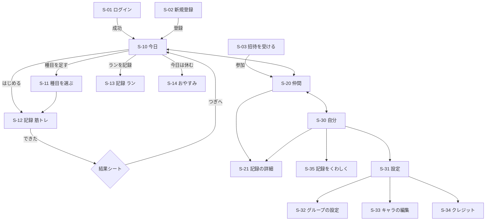

# 画面設計書

## FitLog

画面一覧・画面遷移・ワイヤーフレーム・共通の表示・デザイン方針を定義する。
機能の範囲は [要件定義書（requirements.md）](./requirements.md)、受け入れ条件は [features.md](./features.md)、使う技術は [技術スタック（tech-stack.md）](./tech-stack.md) を正とする。

> 01-5 基本設計で書いた。S-35（記録をくわしく）の中身は、着手するときに詳しく書く。
> 見た目の元はプロトタイプ v8（`prototype/v8/`）。

---

## 1. 画面一覧

URL は静的書き出しのため、詳細ページは動的なパスを使わず `?id=` のように**クエリで表す**（tech-stack.md）。パスの末尾の `/` の扱い（CloudFront で `index.html` に読み替える）は infrastructure.md に書く。
タブは3つ（今日・仲間・自分）。タブの無い画面は全画面で表示する。

| ID | 画面名 | パス | タブ | 主な要素 | 機能 | 優先 |
|----|--------|------|------|----------|------|------|
| S-01 | ログイン | `/login` | なし | メールアドレス・パスワード | F-01 | 必須 |
| S-02 | 新規登録 | `/signup` | なし | メールアドレス・パスワード・表示名 | F-01 | 必須 |
| S-03 | 招待を受ける | `/invite?token=` | なし | グループ名・今の人数（ログイン前でも見える）・「参加する」（未ログインなら「登録して参加」「ログインして参加」。登録・ログインのあと S-03 に戻る） | F-02 | 必須 |
| S-10 | 今日 | `/today` | 今日 | 週の帯（7マス）・「次の1枚」・今日のメニュー・「今日は休む」・送信待ちの帯 | F-03・F-07・F-08・F-30 | 必須 |
| S-11 | 種目を選ぶ | `/exercises` | なし | 部位つきの一覧・検索・「種目を追加」 | F-03 | 必須 |
| S-12 | 記録（筋トレ） | `/record?exercise=` | なし | 種目名・重量×回数・＋/−・前回のバー・「できた」・結果シート | F-03・F-05・F-06・F-13 | 必須 |
| S-13 | 記録（ラン） | `/run` | なし | 距離・時間・GPX を選ぶ・地図 | F-04・F-14・F-15 | 必須 |
| S-14 | おやすみ | `/rest` | なし | くつろぐ姿・責めない一言 | F-08 | 必須 |
| S-20 | 仲間 | `/friends` | 仲間 | 足跡の一覧・週の合計・スタンプ・グループがないときの案内 | F-02・F-09・F-10 | 必須 |
| S-21 | 記録の詳細 | `/record-detail?id=` | なし | セット・ルート・動画・スタンプ・コメント | F-10・F-13・F-15 | 必須 |
| S-30 | 自分 | `/me` | 自分 | ヒートマップ・記録の一覧・「記録をくわしく」・「設定」 | F-12 | 必須 |
| S-31 | 設定 | `/settings` | なし | ユーザー情報・グループ・キャラ・クレジット・ログアウト | F-01・F-02 | 必須 |
| S-32 | グループの設定 | `/settings/group` | なし | メンバー一覧・招待リンクを作る・グループを出る | F-02 | 必須 |
| S-33 | キャラの編集 | `/settings/avatar` | なし | 体型・髪型・髪色・服の色・ズボンの色 | F-32 | できれば |
| S-34 | クレジット | `/settings/credits` | なし | 素材の作者・ライセンス・配布元 URL | F-33 | できれば（F-31・F-32 を出すなら必須） |
| S-35 | 記録をくわしく | `/me/stats` | なし | 週・月・年の切替・今月の数字・グラフ・日本縦断・スタンプ帳 | F-22・F-26〜F-29 | できれば |

**今日のメニュー**: 前回の筋トレの記録があれば、その種目が前回と同じ順で並ぶ（外す・足す・並べ替えもできる）。前回がなければ「種目を選ぶ」から始める。メニューを保存する表は持たず、直近の筋トレの記録（`GET /records?kind=workout&limit=1`）から画面が作る（F-23 メニュー提案を作るときに見直す）。

## 2. 画面構成図

```
ログイン前:  S-01 ログイン ── S-02 新規登録
             S-03 招待を受ける（リンクから。中身はログイン前でも見え、参加はログイン後）

ログイン後:  ┌────────────┬────────────┬────────────┐
             │ 今日 S-10  │ 仲間 S-20  │ 自分 S-30  │   ← 下のタブ
             └────────────┴────────────┴────────────┘
             今日 ─→ 種目を選ぶ S-11 ─→ 記録（筋トレ）S-12
                 ├→ 記録（ラン）S-13
                 └→ おやすみ S-14
             仲間 ─→ 記録の詳細 S-21
             自分 ─→ 記録の詳細 S-21 ／ 記録をくわしく S-35 ／ 設定 S-31
             設定 ─→ グループの設定 S-32 ／ キャラの編集 S-33 ／ クレジット S-34
```

初期表示: ログイン済みなら `/today`、そうでなければ `/login`。

## 3. 画面遷移図



401 が返ったときは、送信待ちを残したまま S-01 へ移り、ログイン後に元の画面へ戻る（features.md の F-30）。

## 4. ワイヤーフレーム

見た目の元は `prototype/v8/`（動くプロトタイプ）。ここには**画面ごとに何を置くか**だけを書き、色・形は 6章に置く。幅 360px（最小）を基準にし、PC では中央に寄せる。

### S-10 今日

```
┌──────────────────────────────┐
│ 10/              [D][W][M]    │ ← 週の帯（ティール）
│ 月 火 水 木 金 土 日          │
│ 20 21 22 23 24 25 26          │   記録=黄の丸 休み=紫の丸 未来=薄い丸
├──────────────────────────────┤
│ [送信待ち 2件 …]              │ ← 送信待ちがあるときだけ（5章）
│        （キャラ）              │
│ ┌────────────────────────┐ │
│ │ NEXT                    │ │ ← 次の1枚
│ │ レッグカール            │ │
│ │ 25kg × 12   前回 25×12  │ │
│ │ [ はじめる ]            │ │
│ └────────────────────────┘ │
│ ほかの種目（今日のメニュー）  │
│  ●1 スクワット      60kg×10  │ ← できた=黄のチェック
│  ○3 レッグカール    25kg×12  │
│  ☾  今日は休む               │
├──────────────────────────────┤
│  今日      仲間      自分     │
└──────────────────────────────┘
```

状態: 朝・昼（まだ記録していない）／記録後（全部できた）／休み／初回（前回なし＝「種目を選ぶ」と、お試しの前回値）／2日以上あいた後（おかえり）。

### S-12 記録（筋トレ）

```
┌──────────────────────────────┐
│ ✕  ━━━━━━━━━━━━━░░░  （キャラ）│ ← 進み具合
│        2 / 4 種目め           │
│        ベンチプレス           │
│       40kg × 11回             │
│     [ − ]  3セット  [ + ]     │
│ ┌ 前回のじぶん  40kg×10 ───┐ │
│ │ 前回 ━━━━━━━━━          │ │
│ │ 今回 ━━━━━━━━━━         │ │
│ └──────────────────────────┘ │
│ [ できた ]（セットごとに押す） │
└──────────────────────────────┘
```

「できた」を押すと、結果シート（「前回超え +1」など）が 0.8 秒出る。タップで飛ばせる。責める言葉は出さない。動画（F-13）は、できた後に「2秒ラストレップを撮る」を結果シートの小さな選択肢として出す（必須ではない）。

### S-20 仲間

```
┌──────────────────────────────┐
│ 今週のグループ  4人が記録      │
│ 総重量 12,400kg ／ 走った 18km │
├──────────────────────────────┤
│ （キャラ）田中  ラン 5.2km     │
│   昨日 20:10   [スタンプ] 💬2  │
│ （キャラ）佐藤  レッグデイ      │
│   昨日 19:30   ほか …          │
│ （キャラ）鈴木  おやすみ        │
├──────────────────────────────┤
│  今日      仲間      自分     │
└──────────────────────────────┘
```

グループがないとき（初回）: 「グループを作る」と「招待リンクで参加する」の2つのボタンと、一言だけ。順位・連続日数は出さない。

### S-30 自分

```
┌──────────────────────────────┐
│ （キャラ） 佐藤      [設定]    │
│ 今週きたえたところ             │
│  （体の図に色。部位ごとの濃さ）│
│ 記録                           │
│  10/22 レッグデイ  ベスト      │
│  10/20 ラン 5.2km             │
│ [ 記録をくわしく ]            │
├──────────────────────────────┤
│  今日      仲間      自分     │
└──────────────────────────────┘
```

ほかの画面（S-01〜S-03・S-11・S-13・S-14・S-21・S-31〜S-35）は、v8 の部品（帯・札・厚みボタン・丸）の組み合わせで作り、実装の計画（02）で画面ごとに確かめる。

## 5. 共通の表示

### 送信待ちの表示（F-30）

電波が無い間に記録したものが「この端末には残っていて、まだサーバーに届いていない」ことを伝える表示。仕組み（楽観的更新・送信待ちの保存・再送）は [tech-stack.md のオフライン記録](./tech-stack.md#オフライン記録f-30) を参照。

**方針: ふだんは何も出さない。送信待ちがある間だけ、画面の上に帯を1本出す**（比較した3案のうち案B）。比較ページは `prototype/v8/sync-status.html`。

#### 出る場所と条件

| 項目 | 内容 |
|------|------|
| 出る場所 | 今日・仲間・自分の3タブの上部（今日タブは週の帯のすぐ下）。記録画面には出さない（下の「できた」直後のシートで伝える） |
| 出す条件 | 一時停止している送信（TanStack Query の `isPaused` の送信）が1件以上あるとき。電波があって送っている最中（ふつうは1秒ほど）は出さない。出すとちらつくため |
| 件数 | 送信待ちの件数（筋トレ・ランの区別なく合計）。今日の画面に出ていない記録（例: 昨日のラン）も数える |
| 記録の見え方 | 送信待ちの記録も、週の帯・種目の行では「記録した」と同じに見せる（楽観的更新）。行ごとの印は付けない |
| キャラ | 使わない。F-31・F-32 を削っても、この表示はそのまま成り立つ |

#### 状態ごとの表示

| 状態 | 帯の色・アイコン | 文言 | 消えるきっかけ |
|------|------------------|------|----------------|
| ふだん（送信待ち0件） | 出さない | - | - |
| 電波なしで送信待ちがある | 薄い灰色・時計 | 「送信待ち N件」＋小さく「この端末に保存ずみ。つながったら自動で送るよ」 | 全部送れたとき（「送った」に切り替わる） |
| 電波が戻って送った | 薄いティール・チェック | 「N件 送ったよ」 | 3秒で消える |
| ログインが切れていた（401） | 薄いコーラル・鍵＋「ログイン」ボタン | 「送信待ち N件」＋小さく「記録は残ってるよ。ログインで送るね」 | ログインし直して全部送れたとき |

- 電波なしで「できた」を押したときは、直後のシートに1行足す: 「この端末に保存したよ。電波が戻ったら送るね」。電波があるときは足さない
- 「ログイン」ボタンはログイン画面へ移る。ログインできたら元の画面に戻り、送信待ちを送り直す
- 帯は `role="status"`（画面の読み上げで、操作を邪魔せずに知らせる）。「送ったよ」の出入りに動きを付ける場合も、`prefers-reduced-motion`（動きを減らす設定）では動かさない
- 色だけで状態を区別しない。アイコンと文言を必ず添える
- **5xx などで送れなかったとき**: 5xx・408・429・電波なしは送信待ちに残して再送し、帯は「送信待ち N件」のまま。400・403・409 は送信待ちから外し、「送れなかった記録があります」を1回だけ知らせる（正本は [design.md 7章](./design.md#7-細かい取り決めテスト設計の洗い出しで決めたもの)。判断ログ 01-7）

#### 比較して採らなかった案

| 案 | 理由 |
|----|------|
| A. 行の小さな印（送れていない記録の行に時計の印） | 今日の画面に出ていない記録（昨日のランなど）が見えず、2件あるのに1件に見える。ログイン切れのときにボタンを置く場所が無い。なぜ送れていないか（電波なし）が伝わらない |
| C. 行の印＋帯 | 同じことを2か所で言うことになる。電波の悪いジムでは毎回、印と帯の両方が出て画面がにぎやかになる。テストする表示も倍になる |
| 常に「保存済み」を出す（文書作成アプリ型） | ふだんの画面に毎回同じ表示が増えるだけになる。困ったときだけ知らせる方が、ホームの要素を少なくする方針に合う（議論の段階で外した。比較ページには出していない） |
| キャラの吹き出しで知らせる | キャラ（F-31）は削る順に入っているので、削ったときに表示ごと消えてしまう（議論の段階で外した） |

#### テスト

| 種類 | 確かめること |
|------|--------------|
| E2E（Playwright） | オフラインにする → 記録 → 帯「送信待ち 1件」が出る → 再読み込みしても帯が残る → オンラインに戻す → 「1件 送ったよ」→ 3秒後に帯が消える → サーバーの記録がちょうど1件（tech-stack.md のテストと同じ1本にまとめる） |
| E2E（Playwright） | API が 401 を返す状態で記録 → 帯にログインボタンが出る → ログイン → 帯が消え、記録が1件 |
| 単体 | 件数は一時停止中の送信だけを数え、送っている最中のものは数えない |

### スタンプと定型コメント（F-10）

features.md の未決を、ここで決める。キーは DB の `reactions.stamp_key`、本文は `comments.body` にそのまま保存する。順位・数を競う言い方は入れない。

| 種類 | キー | 表示 | 使える記録 |
|------|------|------|-----------|
| スタンプ | `nice` | ナイス | 筋トレ・ラン |
| スタンプ | `fire` | すごい | 筋トレ・ラン |
| スタンプ | `clap` | おつかれ | 筋トレ・ラン |
| スタンプ | `smile` | いいね | 筋トレ・ラン |
| スタンプ | `rest_slow` | ゆっくりね | 休み |
| スタンプ | `rest_again` | またあした | 休み |

見た目（アイコン）は実装で決める。絵文字は端末で見え方が違うので、アイコンを推奨する。

| 定型コメント（本文そのまま保存） | 使える記録 |
|------------------------------|-----------|
| ナイス！ | 筋トレ・ラン |
| いい調子！ | 筋トレ・ラン |
| おつかれさま | 筋トレ・ラン |
| 今度いっしょにやろう | 筋トレ・ラン |
| ゆっくり休んでね | 休み |
| また一緒にやろう | 休み |

自由入力は 50 字まで。スタンプ・コメントを付けたり外したりできるのは電波があるときだけ（features.md の F-30）。

### 状態の表示（空・初回・エラー）

| 状況 | 表示 |
|------|------|
| 記録が1件もない（初回） | 今日の「次の1枚」に、お試しの前回値つきの種目を出す。自分タブのヒートマップは薄い体の図と「まだ記録がありません」の一言 |
| グループに入っていない | 仲間タブに「グループを作る」「招待リンクで参加する」の2つだけ（4章） |
| 招待リンクが期限切れ・満員 | S-03 に理由（期限切れ／満員）と、「新しいリンクをもらってください」の一言 |
| 読み込み中 | 骨組み（灰色の枠）を出す。3秒以内を目標にする（requirements 5.2） |
| API のエラー | 画面に出せる日本語の文言（`message`）を出し、内部の事情は出さない（design.md 5章）。5xx で送れなかったときは、上の「送信待ち」の決まりに従う |

## 6. デザイン方針

見た目の方向は [requirements.md の 6 章](./requirements.md)（明るい背景・ティール＋紺・斜めの縞と札・太い斜体の数字）。ここでは、実装で守る値を決める。元は `prototype/v8/index.html`。

### 色（トークン）

| 名前 | 値 | 使うところ |
|------|-----|-----------|
| teal | `#17A2A6` | 週の帯・主なボタンの背景 |
| teal-dark | `#0E7F83` | 厚みボタンの影・白文字を載せる背景（下の表） |
| teal-light | `#D5F0F1` | 結果シート・「送った」の帯の背景 |
| yellow | `#FFC21A`（影 `#D99A00`） | 記録した日・できた |
| coral | `#FF6B5B`（影 `#D94A3B`） | ログイン切れ・注意（赤ではなく責めない色） |
| purple | `#8E7CF0`（影 `#6A57CF`） | 休み・おやすみ |
| ink | `#1E2A3A` | 文字 |
| sub | `#6B7280` | 補足の文字 |
| face / neutral | `#F4F6F8` / `#E5E7EB` | 面・線 |

### 文字と部品

- 文字: 日本語は M PLUS Rounded 1c、数字は Barlow Condensed（太い斜体）。見出し・ボタンは weight 800
- 部品: 厚みボタン（押すと沈む）・斜めに切った札・斜めの縞・丸。角の丸みは 12px
- タップできるものは **44×44px 以上**（WCAG は 24px 以上を求めるが、運動中の指先と汗を考えて 44px にする。v8 の確認で決めた値）
- 動き: `prefers-reduced-motion` のときは止める（キャラは1コマ目、祝福は動かさず表示だけ）

### アクセシビリティ（コントラスト比の実測）

基準は WCAG 2.2 AA（通常の文字 **4.5 以上**、大きい文字〔24px 以上、または太字 18.66px 以上〕**3 以上**）。v8 の色の組み合わせを計算で測った（2026-10-28。相対輝度の式で算出）。

| 組み合わせ | 比 | 判定 | 実装での扱い |
|------------|----|------|--------------|
| 紺 on 黄 | 8.97 | ○ | そのまま |
| 紺 on 薄ティール／薄コーラル | 12.13／12.04 | ○ | そのまま（帯・シートの文字は紺） |
| 白 on 濃ティール `#0E7F83` | 4.79 | ○ | **白文字は濃ティールの上に置く** |
| 灰 `#6B7280` on 白 | 4.83 | ○ | 補足の文字はこの色まで |
| 白 on ティール `#17A2A6` | **3.11** | 大きい文字だけ○ | 週の帯の数字（30px）は可。**ボタンの文字（18px）は不可**＝ボタンの背景を濃ティールにするか、紺の文字にする（紺 on ティールは 4.67） |
| 白 on コーラル `#FF6B5B` | **2.80** | ✕ | 文字は紺（5.19）。ログインボタンの白文字は、背景を `#C23B2D`（5.31）にする |
| 白 on 紫 `#8E7CF0` | **3.34** | 大きい文字だけ○ | 小さい文字は濃い紫 `#6A57CF`（5.42）の上に置く |
| 灰 `#9AA1AB` on 白（タブの非選択） | **2.61** | ✕ | `#6B7280`（4.83）にする |
| 灰 `#6B7280` on `#F4F6F8` | 4.46 | 基準に 0.04 足りない | `#4B5563`（6.98）にする |
| 白 60% on ティール（週の帯の未来の日） | **2.21** | ✕ | 濃ティールの帯にして白 80%（3.65・大きい文字）にする |

**v8 は見た目の確認用のプロトタイプで、ここまでの基準は満たしていない。** 実装（02）では、上の「実装での扱い」に直し、a11y 検査（testing-design.md）で毎回確かめる。色だけで状態を区別しない（アイコンと文字を添える）ことも守る。
